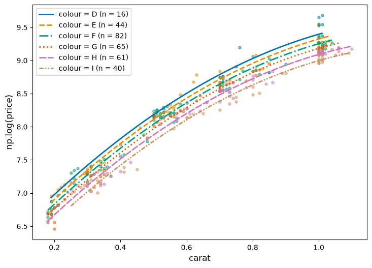
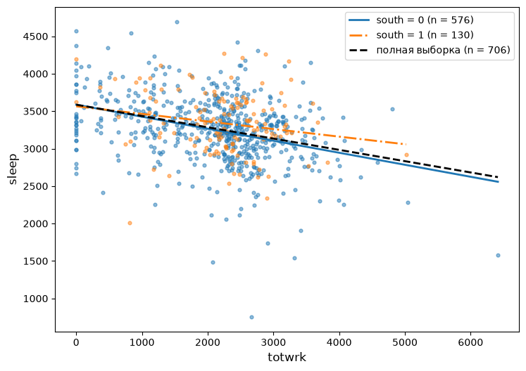
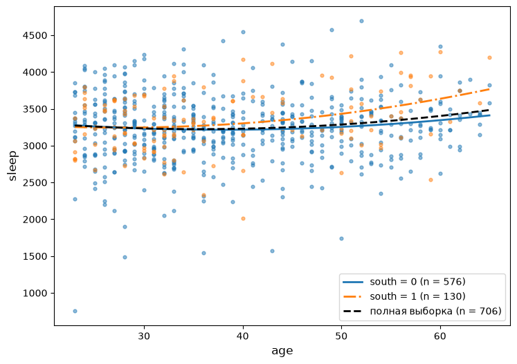

# Задачи по Эконометрике-1: Категориальные регрессоры и структурные сдвиги
Н. В. Артамонов, А. Н. Лата (МГИМО МИД России)

- [Категориальные регрессоры](#категориальные-регрессоры)
  - [diamond equation \#1](#diamond-equation-1)
  - [diamond equation \#2](#diamond-equation-2)
- [Структурные сдвиги](#структурные-сдвиги)
  - [Рисунки: sleep по группам south](#рисунки-sleep-по-группам-south)
  - [sleep equation \#1](#sleep-equation-1)
  - [sleep equation \#2](#sleep-equation-2)
  - [wage equation \#1](#wage-equation-1)
  - [wage equation \#2](#wage-equation-2)

> [!IMPORTANT]
>
> ### Важно
>
> - Логарифм натуральный; константа включается в модель по умолчанию.
> - Данные лежат в `datasets/`, описание переменных — в
>   `datasets/data-description.md`.
> - Ответы округляются до 2-х десятичных знаков, если в задаче не
>   сказано иное; ответы считаются по неокруглённым оценкам.
> - Коэффициенты подписаны так, как их печатает statsmodels: `Intercept`
>   — константа, `np.log(x)` — $\log x$, `I(x ** 2)` — $x^2$, `x:d` —
>   произведение `x` и `d`.
> - `x[T.a]` — бинарная переменная для категории `a` категориального
>   регрессора `x`. Например, `colour[T.E]` равна 1 для бриллиантов
>   цвета E и 0 для остальных. У базовой категории своей строки нет; она
>   названа в условии задачи.
> - В таблицах раздела «Структурные сдвиги» в скобках — неробастные
>   стандартные ошибки.

# Категориальные регрессоры

## diamond equation \#1

Набор данных `Diamond`: `price` — цена, сингапурские доллары; `carat` —
масса, караты; `colour` — цвет от D (лучший) до I; `clarity` — чистота;
`certification` — организация, выдавшая сертификат (GIA, HRD, IGI).

**Описательные статистики**

Для набора данных `Diamond` вычислите описательные статистики
количественных переменных (`df.describe()`) и число наблюдений по
уровням категориальных регрессоров (`df['colour'].value_counts()`).

|       |  carat | price |
|------:|-------:|------:|
| count |    308 |   308 |
|  mean | 0.6309 |  5019 |
|   std | 0.2772 |  3403 |
|   min | 0.1800 |   638 |
|   25% | 0.3500 |  1625 |
|   50% | 0.6200 |  4215 |
|   75% | 0.8500 |  7446 |
|   max | 1.1000 | 16008 |

|                          |   D |   E |   F |   G |   H |   I |
|:-------------------------|----:|----:|----:|----:|----:|----:|
| colour: число наблюдений |  16 |  44 |  82 |  65 |  61 |  40 |

|                           |  IF | VS1 | VS2 | VVS1 | VVS2 |
|:--------------------------|----:|----:|----:|-----:|-----:|
| clarity: число наблюдений |  44 |  81 |  53 |   52 |   78 |

|                                 | GIA | HRD | IGI |
|:--------------------------------|----:|----:|----:|
| certification: число наблюдений | 151 |  79 |  78 |

**Регрессии**

Для набора данных `Diamond` рассмотрим несколько линейных регрессий.

1.  `np.log(price) ~ carat + I(carat**2) + colour`
2.  `np.log(price) ~ carat + I(carat**2) + certification`
3.  `np.log(price) ~ carat + I(carat**2) + colour + certification`

Базовые категории: `colour` — D, `certification` — GIA.

Оцените регрессии и дайте интерпретацию коэффициентам для категориальных
регрессоров. Интерпретацию дайте в процентах: приближённо
($100\cdot\beta$) и точно ($100\cdot(e^{\beta}-1)$). **Ответ округлите
до 2-х десятичных знаков.**

Результаты оценивания

**Модель 1**

| Переменная      | Оценка |
|:----------------|-------:|
| Intercept       |   5.98 |
| colour\[T.E\]   |  -0.07 |
| colour\[T.F\]   |  -0.14 |
| colour\[T.G\]   |  -0.21 |
| colour\[T.H\]   |  -0.30 |
| colour\[T.I\]   |  -0.40 |
| carat           |   5.40 |
| I(carat \*\* 2) |  -1.98 |

Модель была подогнана по 308 наблюдениям.

**Модель 2**

| Переменная             | Оценка |
|:-----------------------|-------:|
| Intercept              |   5.69 |
| certification\[T.HRD\] |   0.03 |
| certification\[T.IGI\] |   0.07 |
| carat                  |   5.65 |
| I(carat \*\* 2)        |  -2.19 |

Модель была подогнана по 308 наблюдениям.

**Модель 3**

| Переменная             | Оценка |
|:-----------------------|-------:|
| Intercept              |   5.87 |
| colour\[T.E\]          |  -0.08 |
| colour\[T.F\]          |  -0.15 |
| colour\[T.G\]          |  -0.23 |
| colour\[T.H\]          |  -0.31 |
| colour\[T.I\]          |  -0.41 |
| certification\[T.HRD\] |   0.04 |
| certification\[T.IGI\] |   0.09 |
| carat                  |   5.67 |
| I(carat \*\* 2)        |  -2.15 |

Модель была подогнана по 308 наблюдениям.

Рисунок 1: np.log(price) и carat по категориям colour (Diamond):
категориальный регрессор сдвигает кривую параллельно

> [!TIP]
>
> ### Ответ
>
> **Модель 1.** Базовая категория — цвет D (лучший). При той же массе
> бриллиант дешевле бриллианта цвета D: E — на 7 % (7.0 %), F — на 14 %
> (13.3 %), G — на 21 % (19.2 %), H — на 30 % (26.3 %), I — на 40 %
> (32.9 %). Первое число — приближённая оценка $100\cdot\beta$, в
> скобках — точная $100\cdot(e^{\beta}-1)$; чем больше
> $\lvert\beta\rvert$, тем сильнее они расходятся. Коэффициент при
> `colour[T.E]` — вертикальный сдвиг кривой относительно кривой цвета D
> (<a href="#fig-diamond-colour" class="quarto-xref">Рисунок 1</a>).
>
> **Модель 2.** Базовая категория — сертификат GIA. При той же массе
> бриллиант дороже бриллианта с сертификатом GIA: HRD — на 3 % (3.2 %),
> IGI — на 7 % (7.0 %).

## diamond equation \#2

Набор данных `diamonds`: `price` — цена, долл. США; `carat` — масса,
караты; `cut` — качество огранки от Fair (худшее) до Ideal; `color` —
цвет от D (лучший) до J; `clarity` — чистота; `x`, `y`, `z` — длина,
ширина, высота в мм.

**Описательные статистики**

Для набора данных `diamonds` вычислите описательные статистики
количественных переменных (`df.describe()`) и число наблюдений по
уровням категориальных регрессоров (`df['cut'].value_counts()`).

Какие значения в таблице описательных статистик выглядят ошибочными?
Сколько таких наблюдений?

|       |  carat | depth | table | price |      x |      y |      z |
|------:|-------:|------:|------:|------:|-------:|-------:|-------:|
| count |  53940 | 53940 | 53940 | 53940 |  53940 |  53940 |  53940 |
|  mean | 0.7979 | 61.75 | 57.46 |  3933 |  5.731 |  5.735 |  3.539 |
|   std | 0.4740 |  1.43 |  2.23 |  3989 |  1.122 |  1.142 |  0.706 |
|   min | 0.2000 | 43.00 | 43.00 |   326 |  0.000 |  0.000 |  0.000 |
|   25% | 0.4000 | 61.00 | 56.00 |   950 |  4.710 |  4.720 |  2.910 |
|   50% | 0.7000 | 61.80 | 57.00 |  2401 |  5.700 |  5.710 |  3.530 |
|   75% | 1.0400 | 62.50 | 59.00 |  5324 |  6.540 |  6.540 |  4.040 |
|   max | 5.0100 | 79.00 | 95.00 | 18823 | 10.740 | 58.900 | 31.800 |

|                       | Fair | Good | Very Good | Premium | Ideal |
|:----------------------|-----:|-----:|----------:|--------:|------:|
| cut: число наблюдений | 1610 | 4906 |     12082 |   13791 | 21551 |

|                         |    D |    E |    F |     G |    H |    I |    J |
|:------------------------|-----:|-----:|-----:|------:|-----:|-----:|-----:|
| color: число наблюдений | 6775 | 9797 | 9542 | 11292 | 8304 | 5422 | 2808 |

|                           |  I1 |  SI2 |   SI1 |   VS2 |  VS1 | VVS2 | VVS1 |   IF |
|:--------------------------|----:|-----:|------:|------:|-----:|-----:|-----:|-----:|
| clarity: число наблюдений | 741 | 9194 | 13065 | 12258 | 8171 | 5066 | 3655 | 1790 |

> [!TIP]
>
> ### Ответ
>
> Нулевые минимумы размеров `x`, `y`, `z` (число наблюдений с нулём: `x`
> — 8, `y` — 7, `z` — 20) и максимумы `y` = 58.9 мм, `z` = 31.8 мм при
> третьих квартилях 6.54 и 4.04 мм.

**Регрессии**

Для набора данных `diamonds` рассмотрим несколько линейных регрессий.

1.  `np.log(price) ~ carat + I(carat**2) + cut + x + y + z`
2.  `np.log(price) ~ carat + I(carat**2) + color + x + y + z`
3.  `np.log(price) ~ carat + I(carat**2) + color + cut + x + y + z`

Базовые категории: `cut` — Fair, `color` — D.

Оцените регрессии и дайте интерпретацию коэффициентам для категориальных
регрессоров. Интерпретацию дайте в процентах: приближённо
($100\cdot\beta$) и точно ($100\cdot(e^{\beta}-1)$). **Ответ округлите
до 2-х десятичных знаков.**

Результаты оценивания

**Модель 1**

| Переменная         | Оценка |
|:-------------------|-------:|
| Intercept          |   3.80 |
| cut\[T.Good\]      |   0.12 |
| cut\[T.Very Good\] |   0.17 |
| cut\[T.Premium\]   |   0.16 |
| cut\[T.Ideal\]     |   0.24 |
| carat              |   2.37 |
| I(carat \*\* 2)    |  -0.64 |
| x                  |   0.38 |
| y                  |   0.02 |
| z                  |   0.06 |

Модель была подогнана по 53940 наблюдениям.

**Модель 2**

| Переменная      | Оценка |
|:----------------|-------:|
| Intercept       |   4.08 |
| color\[T.E\]    |  -0.03 |
| color\[T.F\]    |  -0.04 |
| color\[T.G\]    |  -0.07 |
| color\[T.H\]    |  -0.21 |
| color\[T.I\]    |  -0.30 |
| color\[T.J\]    |  -0.43 |
| carat           |   2.35 |
| I(carat \*\* 2) |  -0.61 |
| x               |   0.38 |
| y               |   0.03 |
| z               |   0.05 |

Модель была подогнана по 53940 наблюдениям.

**Модель 3**

| Переменная         | Оценка |
|:-------------------|-------:|
| Intercept          |   3.99 |
| color\[T.E\]       |  -0.03 |
| color\[T.F\]       |  -0.04 |
| color\[T.G\]       |  -0.07 |
| color\[T.H\]       |  -0.21 |
| color\[T.I\]       |  -0.31 |
| color\[T.J\]       |  -0.43 |
| cut\[T.Good\]      |   0.12 |
| cut\[T.Very Good\] |   0.18 |
| cut\[T.Premium\]   |   0.16 |
| cut\[T.Ideal\]     |   0.25 |
| carat              |   2.54 |
| I(carat \*\* 2)    |  -0.65 |
| x                  |   0.34 |
| y                  |   0.01 |
| z                  |   0.06 |

Модель была подогнана по 53940 наблюдениям.

> [!TIP]
>
> ### Ответ
>
> **Модель 1.** Базовая категория — огранка Fair (худшая). При тех же
> массе и размерах бриллиант дороже бриллианта с огранкой Fair: Good —
> на 12 % (12.3 %), Very Good — на 17 % (18.9 %), Premium — на 16 %
> (16.8 %), Ideal — на 24 % (27.7 %). Первое число — приближённая оценка
> $100\cdot\beta$, в скобках — точная $100\cdot(e^{\beta}-1)$.
>
> **Модель 2.** Базовая категория — цвет D (лучший). При тех же массе и
> размерах бриллиант дешевле бриллианта цвета D: E — на 3 % (3.1 %), F —
> на 4 % (3.9 %), G — на 7 % (6.5 %), H — на 21 % (18.9 %), I — на 30 %
> (26.2 %), J — на 43 % (35.2 %).

# Структурные сдвиги

## Рисунки: sleep по группам south

Набор данных `sleep75`: `sleep`, `totwrk` — сон и работа, минут в
неделю; `age` — возраст, лет; `smsa` = 1 — живёт в крупной городской
агломерации; `south` = 1 — южные штаты; `male` = 1 — мужчина.

<a href="#fig-sleep-totwrk" class="quarto-xref">Рисунок 2</a> —
диаграмма рассеяния `sleep` и `totwrk` (набор данных `sleep75`) и три
прямые МНК: по полной выборке, по наблюдениям с `south = 0` и с
`south = 1`. <a href="#fig-sleep-age" class="quarto-xref">Рисунок 3</a>
— то же для регрессии **sleep на age, I(age\*\*2)**.

Рисунок 2: sleep на totwrk: подгонка по полной выборке и отдельно для
south = 0 и south = 1

Рисунок 3: sleep на age, I(age\*\*2): подгонка по полной выборке и
отдельно для south = 0 и south = 1

Чем различаются прямые для `south = 0` и `south = 1`
(<a href="#fig-sleep-totwrk" class="quarto-xref">Рисунок 2</a>):
сдвигом, наклоном или и тем и другим?

Почему линия полной выборки почти совпадает с линией `south = 0`?

Какими регрессорами нужно дополнить модель **sleep на totwrk**, чтобы
одна регрессия дала обе прямые?

> [!TIP]
>
> ### Ответ
>
> Различается в основном наклон: -0.160 при `south = 0` и -0.101 при
> `south = 1`; константы близки (3586.7 и 3564.9). На группу `south = 0`
> приходится 576 наблюдений из 706, поэтому она определяет линию полной
> выборки. Модель нужно дополнить регрессорами `south` (сдвиг константы)
> и `totwrk:south` (сдвиг наклона).

## sleep equation \#1

Для набора данных `sleep75` рассмотрим регрессию **sleep на totwrk, age,
smsa**: исходную (1) и со структурными сдвигами относительно бинарной
переменной `male` (1 — мужчина) (2):

`sleep ~ totwrk + age + smsa + male + totwrk:male + age:male + smsa:male`

Результаты оценивания

|                     |    \(1\)     |    \(2\)     |
|:--------------------|:------------:|:------------:|
| Dep. Variable       |    sleep     |    sleep     |
| Intercept           |   3498.670   |   3486.973   |
|                     |   (69.133)   |   (92.418)   |
| totwrk              | -0.150\*\*\* | -0.143\*\*\* |
|                     |   (0.017)    |   (0.026)    |
| age                 |  2.997\*\*   |    1.704     |
|                     |   (1.393)    |   (2.085)    |
| smsa                | -73.501\*\*  |   -56.649    |
|                     |   (32.219)   |   (48.902)   |
| male                |              |   135.200    |
|                     |              |  (143.832)   |
| totwrk:male         |              |    -0.045    |
|                     |              |   (0.036)    |
| age:male            |              |    1.500     |
|                     |              |   (2.825)    |
| smsa:male           |              |   -34.735    |
|                     |              |   (64.938)   |
| R-squared           |    0.115     |    0.126     |
| R-squared Adj.      |    0.112     |    0.117     |
| F Statistic         | 30.527\*\*\* | 14.387\*\*\* |
| Observations        |     706      |     706      |
| Residual Std. Error |   418.877    |   417.530    |

*Signif. codes:* `***` $p<0.01$, `**` $p<0.05$, `*` $p<0.1$. В скобках —
неробастные стандартные ошибки.

Для регрессии (2) выпишите оценённое уравнение отдельно для `male = 0` и
для `male = 1`. Что показывают коэффициенты при `male` и при `age:male`?
**Ответ округлите до 3-х десятичных знаков.**

> [!TIP]
>
> ### Ответ
>
> - `male = 0`: sleep = 3486.973 − 0.143·totwrk + 1.704·age −
>   56.649·smsa
> - `male = 1`: sleep = 3622.172 − 0.188·totwrk + 3.204·age −
>   91.384·smsa
>
> Коэффициент при `male` (135.200) — разность констант двух уравнений.
> Коэффициент при `age:male` (1.500) — разность коэффициентов при `age`:
> 3.204 при `male = 1` против 1.704 при `male = 0`. У мужчин
> дополнительный год возраста связан со сном, большим на 1.500 мин. в
> неделю, чем у женщин.

## sleep equation \#2

Для набора данных `sleep75` рассмотрим регрессию **sleep на totwrk, age,
smsa**: исходную (1) и со структурными сдвигами относительно бинарной
переменной `south` (1 — южные штаты) (2):

`sleep ~ totwrk + age + smsa + south + totwrk:south + age:south + smsa:south`

Результаты оценивания

|                     |    \(1\)     |    \(2\)     |
|:--------------------|:------------:|:------------:|
| Dep. Variable       |    sleep     |    sleep     |
| Intercept           |   3498.670   |   3557.513   |
|                     |   (69.133)   |   (75.504)   |
| totwrk              | -0.150\*\*\* | -0.161\*\*\* |
|                     |   (0.017)    |   (0.018)    |
| age                 |  2.997\*\*   |    1.485     |
|                     |   (1.393)    |   (1.545)    |
| smsa                | -73.501\*\*  |  -61.554\*   |
|                     |   (32.219)   |   (34.856)   |
| south               |              | -407.206\*\* |
|                     |              |  (189.627)   |
| totwrk:south        |              |    0.078     |
|                     |              |   (0.050)    |
| age:south           |              |  8.267\*\*   |
|                     |              |   (3.495)    |
| smsa:south          |              |    49.429    |
|                     |              |  (107.111)   |
| R-squared           |    0.115     |    0.131     |
| R-squared Adj.      |    0.112     |    0.122     |
| F Statistic         | 30.527\*\*\* | 15.039\*\*\* |
| Observations        |     706      |     706      |
| Residual Std. Error |   418.877    |   416.341    |

*Signif. codes:* `***` $p<0.01$, `**` $p<0.05$, `*` $p<0.1$. В скобках —
неробастные стандартные ошибки.

Для регрессии (2) выпишите оценённое уравнение отдельно для `south = 0`
и для `south = 1`. Что показывают коэффициенты при `south` и при
`age:south`? **Ответ округлите до 3-х десятичных знаков.**

> [!TIP]
>
> ### Ответ
>
> - `south = 0`: sleep = 3557.513 − 0.161·totwrk + 1.485·age −
>   61.554·smsa
> - `south = 1`: sleep = 3150.307 − 0.082·totwrk + 9.752·age −
>   12.125·smsa
>
> Коэффициент при `south` (-407.206) — разность констант двух уравнений.
> Коэффициент при `age:south` (8.267) — разность коэффициентов при
> `age`: 9.752 при `south = 1` против 1.485 при `south = 0`. На Юге
> дополнительный год возраста связан со сном, большим на 8.267 мин. в
> неделю, чем вне Юга.

## wage equation \#1

Набор данных `wage2`: `wage` — месячная зарплата, долл.; `age` —
возраст, лет; `IQ` — результат теста IQ; `urban` = 1 — живёт в городе;
`married` = 1 — в браке; `south` = 1 — южные штаты.

Для набора данных `wage2` рассмотрим регрессию **np.log(wage) на age,
IQ, urban, married**: исходную (1) и со структурными сдвигами
относительно бинарной переменной `south` (1 — южные штаты) (2):

    np.log(wage) ~ age + IQ + urban + married + south +
        age:south + IQ:south + urban:south + married:south

Результаты оценивания

|                     |    \(1\)     |    \(2\)     |
|:--------------------|:------------:|:------------:|
| Dep. Variable       | np.log(wage) | np.log(wage) |
| Intercept           |    4.849     |    4.914     |
|                     |   (0.163)    |   (0.204)    |
| age                 | 0.022\*\*\*  | 0.024\*\*\*  |
|                     |   (0.004)    |   (0.005)    |
| IQ                  | 0.009\*\*\*  | 0.008\*\*\*  |
|                     |   (0.001)    |   (0.001)    |
| urban               | 0.186\*\*\*  | 0.217\*\*\*  |
|                     |   (0.028)    |   (0.035)    |
| married             | 0.198\*\*\*  | 0.201\*\*\*  |
|                     |   (0.041)    |   (0.049)    |
| south               |              |    -0.011    |
|                     |              |   (0.348)    |
| age:south           |              |    -0.007    |
|                     |              |   (0.009)    |
| IQ:south            |              |    0.002     |
|                     |              |   (0.002)    |
| urban:south         |              |  -0.114\*\*  |
|                     |              |   (0.057)    |
| married:south       |              |    -0.003    |
|                     |              |   (0.087)    |
| R-squared           |    0.188     |    0.205     |
| R-squared Adj.      |    0.184     |    0.197     |
| F Statistic         | 53.799\*\*\* | 26.481\*\*\* |
| Observations        |     935      |     935      |
| Residual Std. Error |    0.380     |    0.377     |

*Signif. codes:* `***` $p<0.01$, `**` $p<0.05$, `*` $p<0.1$. В скобках —
неробастные стандартные ошибки.

Для регрессии (2) выпишите оценённое уравнение отдельно для `south = 0`
и для `south = 1`. Что показывают коэффициенты при `south` и при
`urban:south`? **Ответ округлите до 3-х десятичных знаков.**

> [!TIP]
>
> ### Ответ
>
> - `south = 0`: np.log(wage) = 4.914 + 0.024·age + 0.008·IQ +
>   0.217·urban + 0.201·married
> - `south = 1`: np.log(wage) = 4.903 + 0.017·age + 0.010·IQ +
>   0.103·urban + 0.198·married
>
> Коэффициент при `south` (-0.011) — разность констант двух уравнений.
> Коэффициент при `urban:south` (-0.114) — разность коэффициентов при
> `urban`: 0.103 при `south = 1` против 0.217 при `south = 0`. Зависимая
> переменная — логарифм, поэтому разность читается в процентных пунктах:
> на Юге надбавка за жизнь в городе приближённо на 11.4 п. п. меньше
> (10.3 % против 21.7 %).

## wage equation \#2

Для набора данных `wage2` рассмотрим регрессию **np.log(wage) на age,
IQ, south**: исходную (1) и со структурными сдвигами относительно
бинарной переменной `urban` (1 — живёт в городе) (2):

`np.log(wage) ~ age + IQ + south + urban + age:urban + IQ:urban + south:urban`

Результаты оценивания

|                     |    \(1\)     |    \(2\)     |
|:--------------------|:------------:|:------------:|
| Dep. Variable       | np.log(wage) | np.log(wage) |
| Intercept           |    5.214     |    4.999     |
|                     |   (0.168)    |   (0.312)    |
| age                 | 0.023\*\*\*  | 0.024\*\*\*  |
|                     |   (0.004)    |   (0.007)    |
| IQ                  | 0.008\*\*\*  | 0.008\*\*\*  |
|                     |   (0.001)    |   (0.002)    |
| south               | -0.113\*\*\* |    -0.014    |
|                     |   (0.028)    |   (0.052)    |
| urban               |              |    0.237     |
|                     |              |   (0.368)    |
| age:urban           |              |    -0.001    |
|                     |              |   (0.009)    |
| IQ:urban            |              |  -1.41e-05   |
|                     |              |   (0.002)    |
| south:urban         |              |   -0.117\*   |
|                     |              |   (0.061)    |
| R-squared           |    0.146     |    0.182     |
| R-squared Adj.      |    0.143     |    0.176     |
| F Statistic         | 52.872\*\*\* | 29.417\*\*\* |
| Observations        |     935      |     935      |
| Residual Std. Error |    0.390     |    0.382     |

*Signif. codes:* `***` $p<0.01$, `**` $p<0.05$, `*` $p<0.1$. В скобках —
неробастные стандартные ошибки.

Для регрессии (2) выпишите оценённое уравнение отдельно для `urban = 0`
и для `urban = 1`. Что показывают коэффициенты при `urban` и при
`south:urban`? **Ответ округлите до 3-х десятичных знаков.**

> [!TIP]
>
> ### Ответ
>
> - `urban = 0`: np.log(wage) = 4.999 + 0.024·age + 0.008·IQ −
>   0.014·south
> - `urban = 1`: np.log(wage) = 5.235 + 0.024·age + 0.008·IQ −
>   0.131·south
>
> Коэффициент при `urban` (0.237) — разность констант двух уравнений.
> Коэффициент при `south:urban` (-0.117) — разность коэффициентов при
> `south`: -0.131 при `urban = 1` против -0.014 при `urban = 0`.
> Зависимая переменная — логарифм, поэтому разность читается в
> процентных пунктах: в городе отставание зарплаты на Юге приближённо на
> 11.7 п. п. больше (13.1 % против 1.4 %).
