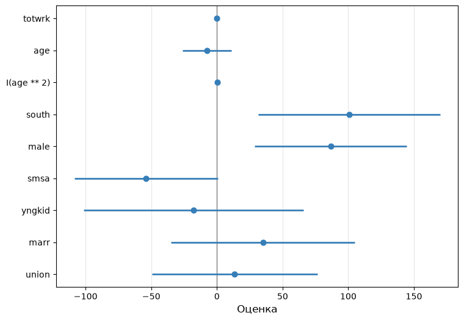
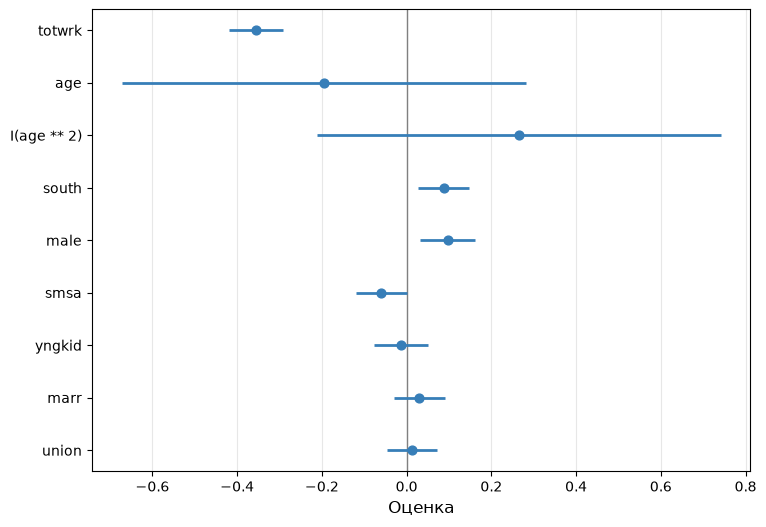
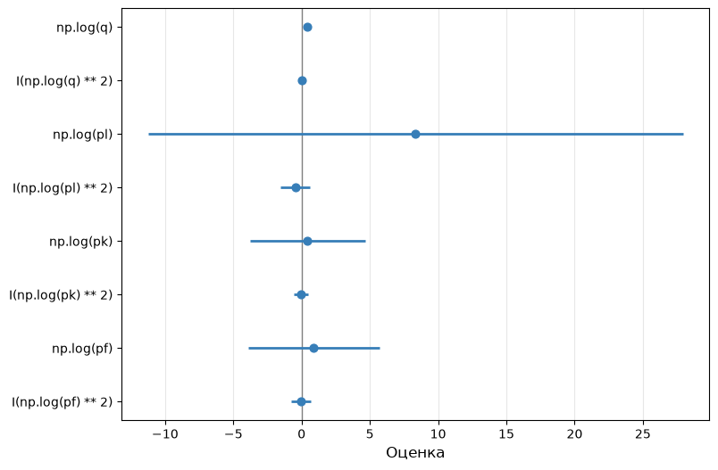
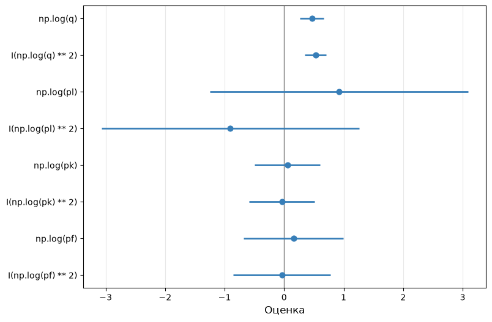
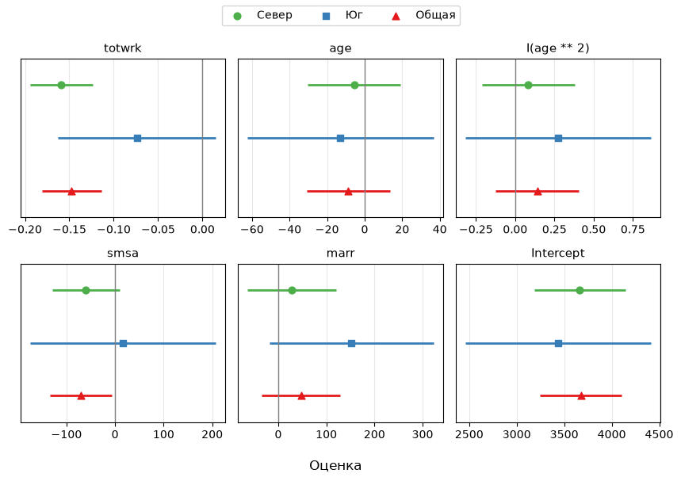

# Задачи по Эконометрике-1: Доверительные интервалы
Н. В. Артамонов, А. Н. Лата (МГИМО МИД России)

- [Построение доверительных
  интервалов](#построение-доверительных-интервалов)
  - [sleep equation \#1](#sleep-equation-1)
  - [output equation](#output-equation)
  - [cost equation \#1](#cost-equation-1)
- [Доверительные интервалы и t-тест](#доверительные-интервалы-и-t-тест)
  - [sleep equation \#2](#sleep-equation-2)
  - [cost equation \#2](#cost-equation-2)
- [Доверительные интервалы и сравнение
  моделей](#доверительные-интервалы-и-сравнение-моделей)
  - [sleep equation \#3](#sleep-equation-3)

> [!IMPORTANT]
>
> ### Важно
>
> - Логарифм натуральный; константа включается в модель по умолчанию.
> - Данные лежат в `datasets/` (`sleep75.csv`, `Labour.csv`,
>   `Electricity.csv`), описание — в `datasets/data-description.md`.
> - Ответы округляются до 3-х десятичных знаков и считаются по
>   неокруглённым оценкам.
> - Коэффициенты подписаны как в statsmodels: `Intercept` — константа,
>   `np.log(x)` — $\log x$, `I(x ** 2)` — $x^2$.
> - Робастные стандартные ошибки — HC3; границы доверительных интервалов
>   — по квантилям t-распределения: `fit(cov_type='HC3', use_t=True)`,
>   затем `conf_int(alpha=…)`.

# Построение доверительных интервалов

## sleep equation \#1

Для набора данных `sleep75` рассмотрим регрессию (`sleep` и `totwrk` —
минуты в неделю)

`sleep ~ totwrk + age + south + male + smsa + yngkid + marr`

Постройте 90%-доверительные интервалы (неробастные и робастные) для
каждого коэффициента. **Ответ округлите до 3-х десятичных знаков.**

Ответ:

**90%-е доверительные интервалы (неробастные стандартные ошибки):**

| Переменная | Нижняя граница | Верхняя граница |
|:-----------|---------------:|----------------:|
| Intercept  |       3317.954 |        3583.872 |
| totwrk     |         -0.199 |          -0.139 |
| age        |          0.269 |           5.109 |
| south      |         32.662 |         170.475 |
| male       |         29.851 |         145.487 |
| smsa       |       -109.302 |          -0.193 |
| yngkid     |        -96.876 |          68.952 |
| marr       |        -38.349 |         100.770 |

**90%-е доверительные интервалы (робастные стандартные ошибки, HC3):**

| Переменная | Нижняя граница | Верхняя граница |
|:-----------|---------------:|----------------:|
| Intercept  |       3301.820 |        3600.005 |
| totwrk     |         -0.203 |          -0.136 |
| age        |          0.318 |           5.061 |
| south      |         31.548 |         171.588 |
| male       |         28.619 |         146.719 |
| smsa       |       -109.835 |           0.340 |
| yngkid     |       -103.344 |          75.419 |
| marr       |        -44.867 |         107.289 |

Модель была подогнана по 706 наблюдениям.

## output equation

Для набора данных `Labour` рассмотрим регрессию **np.log(output) на
np.log(capital), np.log(labour)** (`output` — добавленная стоимость,
`capital` — основные фонды, млн евро; `labour` — число работников).

Постройте 95%-доверительные интервалы (неробастные и робастные) для
каждого коэффициента. **Ответ округлите до 3-х десятичных знаков.**

Ответ:

**95%-е доверительные интервалы (неробастные стандартные ошибки):**

| Переменная      | Нижняя граница | Верхняя граница |
|:----------------|---------------:|----------------:|
| Intercept       |         -1.901 |          -1.522 |
| np.log(capital) |          0.174 |           0.241 |
| np.log(labour)  |          0.669 |           0.760 |

**95%-е доверительные интервалы (робастные стандартные ошибки, HC3):**

| Переменная      | Нижняя граница | Верхняя граница |
|:----------------|---------------:|----------------:|
| Intercept       |         -2.073 |          -1.350 |
| np.log(capital) |          0.146 |           0.270 |
| np.log(labour)  |          0.629 |           0.801 |

Модель была подогнана по 569 наблюдениям.

## cost equation \#1

Для набора данных `Electricity` рассмотрим регрессию (`cost` — общие
издержки, `q` — выпуск, `pl`, `pk`, `pf` — цены труда, капитала и
топлива)

    np.log(cost) ~ np.log(q) + I(np.log(q)**2) +
                   np.log(pl) + np.log(pk) + np.log(pf)

Постройте 99%-доверительные интервалы (неробастные и робастные) для
каждого коэффициента. **Ответ округлите до 3-х десятичных знаков.**

Ответ:

**99%-е доверительные интервалы (неробастные стандартные ошибки):**

| Переменная          | Нижняя граница | Верхняя граница |
|:--------------------|---------------:|----------------:|
| Intercept           |         -8.581 |          -4.896 |
| np.log(q)           |          0.320 |           0.486 |
| I(np.log(q) \*\* 2) |          0.025 |           0.036 |
| np.log(pl)          |         -0.038 |           0.330 |
| np.log(pk)          |          0.007 |           0.308 |
| np.log(pf)          |          0.573 |           0.796 |

**99%-е доверительные интервалы (робастные стандартные ошибки, HC3):**

| Переменная          | Нижняя граница | Верхняя граница |
|:--------------------|---------------:|----------------:|
| Intercept           |         -8.949 |          -4.529 |
| np.log(q)           |          0.230 |           0.576 |
| I(np.log(q) \*\* 2) |          0.020 |           0.041 |
| np.log(pl)          |         -0.077 |           0.369 |
| np.log(pk)          |         -0.005 |           0.320 |
| np.log(pf)          |          0.549 |           0.820 |

Модель была подогнана по 158 наблюдениям.

# Доверительные интервалы и t-тест

## sleep equation \#2

Для набора данных `sleep75` рассмотрим регрессию

    sleep ~ totwrk + age + I(age**2) + south + male + smsa + yngkid + marr + union

Ниже приведены 90%-доверительные интервалы для коэффициентов.

**90%-е доверительные интервалы (неробастные стандартные ошибки):**

| Переменная    | Нижняя граница | Верхняя граница |
|:--------------|---------------:|----------------:|
| Intercept     |       3269.356 |        4007.222 |
| totwrk        |         -0.197 |          -0.137 |
| age           |        -26.347 |          11.084 |
| I(age \*\* 2) |         -0.098 |           0.347 |
| south         |         31.483 |         169.733 |
| male          |         28.681 |         144.571 |
| smsa          |       -108.584 |           0.775 |
| yngkid        |       -101.543 |          65.622 |
| marr          |        -34.936 |         104.904 |
| union         |        -49.590 |          76.328 |

Модель была подогнана по 706 наблюдениям.

> [!IMPORTANT]
>
> ### Условия теста
>
> - уровень значимости: **10%**
> - стандартные ошибки: **неробастные**
> - гипотеза: $H_0:\beta_j=0$ для каждого коэффициента, альтернатива
>   двусторонняя

Какие коэффициенты значимы?

Коэффициент значим на уровне 10%, если 90%-доверительный интервал не
содержит ноль.

> [!NOTE]
>
> ### Коэффициенты, значимые на уровне 10% (по неробастным стандартным ошибкам)
>
> `totwrk`, `south`, `male`

На <a href="#fig-sleep-ci" class="quarto-xref">Рисунок 1</a> интервалы
показаны в исходных единицах (константа не показана).

Рисунок 1: sleep equation \#2: 90%-доверительные интервалы для
коэффициентов

Почему интервалы для `totwrk` и `I(age ** 2)` на рисунке почти не видны?
Значит ли это, что эти коэффициенты оценены точнее остальных?

> [!TIP]
>
> ### Ответ
>
> Нет: ширина интервала зависит от единиц измерения регрессора. `totwrk`
> измерен в минутах в неделю, поэтому коэффициент и его стандартная
> ошибка малы по величине. Чтобы сравнивать коэффициенты между собой, их
> приводят к одному масштабу —
> <a href="#fig-sleep-ci-std" class="quarto-xref">Рисунок 2</a>.

Шкалированный коэффициент показывает, на сколько стандартных отклонений
меняется зависимая переменная при увеличении регрессора на одно
стандартное отклонение; значимость коэффициентов при шкалировании не
меняется.

Рисунок 2: sleep equation \#2: 90%-доверительные интервалы для
шкалированных коэффициентов

## cost equation \#2

Для набора данных `Electricity` рассмотрим регрессию

    np.log(cost) ~ np.log(q) + I(np.log(q)**2) + np.log(pl) + I(np.log(pl)**2) +
                   np.log(pk) + I(np.log(pk)**2) + np.log(pf) + I(np.log(pf)**2)

Ниже приведены 99%-доверительные интервалы для коэффициентов.

**99%-е доверительные интервалы (робастные стандартные ошибки, HC3):**

| Переменная           | Нижняя граница | Верхняя граница |
|:---------------------|---------------:|----------------:|
| Intercept            |       -129.940 |          41.133 |
| np.log(q)            |          0.223 |           0.570 |
| I(np.log(q) \*\* 2)  |          0.020 |           0.042 |
| np.log(pl)           |        -11.254 |          27.921 |
| I(np.log(pl) \*\* 2) |         -1.544 |           0.633 |
| np.log(pk)           |         -3.795 |           4.668 |
| I(np.log(pk) \*\* 2) |         -0.559 |           0.487 |
| np.log(pf)           |         -3.909 |           5.707 |
| I(np.log(pf) \*\* 2) |         -0.734 |           0.673 |

Модель была подогнана по 158 наблюдениям.

> [!IMPORTANT]
>
> ### Условия теста
>
> - уровень значимости: **1%**
> - стандартные ошибки: **робастные (HC3)**
> - гипотеза: $H_0:\beta_j=0$ для каждого коэффициента, альтернатива
>   двусторонняя

Какие коэффициенты значимы?

Коэффициент значим на уровне 1%, если 99%-доверительный интервал не
содержит ноль.

> [!NOTE]
>
> ### Коэффициенты, значимые на уровне 1% (по робастным стандартным ошибкам HC3)
>
> `np.log(q)`, `I(np.log(q) ** 2)`

На <a href="#fig-cost-ci" class="quarto-xref">Рисунок 3</a> интервалы
показаны в исходных единицах (константа не показана).

Рисунок 3: cost equation \#2: робастные 99%-доверительные интервалы для
коэффициентов

Почему интервал для `np.log(pl)` намного шире остальных, а интервалы для
`np.log(q)` и `I(np.log(q) ** 2)` почти не видны?

> [!TIP]
>
> ### Ответ
>
> Ширина интервала зависит от разброса регрессора: `np.log(pl)` меняется
> в выборке мало (стандартное отклонение 0.17 против 1.81 у
> `np.log(q)`). Кроме того, `np.log(pl)` и его квадрат почти линейно
> зависимы, поэтому оба коэффициента оценены неточно. Чтобы сравнивать
> коэффициенты между собой, их приводят к одному масштабу —
> <a href="#fig-cost-ci-std" class="quarto-xref">Рисунок 4</a>: интервал
> для `np.log(pl)` остаётся самым широким.

Шкалированный коэффициент показывает, на сколько стандартных отклонений
меняется зависимая переменная при увеличении регрессора на одно
стандартное отклонение; значимость коэффициентов при шкалировании не
меняется.

Рисунок 4: cost equation \#2: робастные 99%-доверительные интервалы для
шкалированных коэффициентов

# Доверительные интервалы и сравнение моделей

## sleep equation \#3

Для набора данных `sleep75` регрессия

`sleep ~ totwrk + age + I(age**2) + smsa + marr`

оценена по трём выборкам: Север (`south = 0`), Юг (`south = 1`) и общая.
В таблице — оценки и стандартные ошибки, на
<a href="#fig-models-ci" class="quarto-xref">Рисунок 5</a> —
95%-доверительные интервалы.

|                     | Север          | Юг             | Общая          |
|:--------------------|:---------------|:---------------|:---------------|
| Dep. Variable       | sleep          | sleep          | sleep          |
| totwrk              | -0.159\*\*\*   | -0.074         | -0.147\*\*\*   |
|                     | (0.018)        | (0.045)        | (0.017)        |
| age                 | -5.507         | -12.882        | -8.675         |
|                     | (12.557)       | (25.039)       | (11.271)       |
| I(age \*\* 2)       | 0.084          | 0.273          | 0.140          |
|                     | (0.150)        | (0.299)        | (0.135)        |
| smsa                | -59.812\*      | 16.055         | -69.924\*\*    |
|                     | (35.379)       | (96.789)       | (32.330)       |
| marr                | 28.034         | 152.296\*      | 47.598         |
|                     | (46.960)       | (86.153)       | (41.450)       |
| Intercept           | 3664.188\*\*\* | 3435.410\*\*\* | 3675.413\*\*\* |
|                     | (244.380)      | (494.979)      | (219.803)      |
| R-squared           | 0.129          | 0.140          | 0.118          |
| R-squared Adj.      | 0.122          | 0.106          | 0.112          |
| F Statistic         | 16.928\*\*\*   | 4.043\*\*\*    | 18.768\*\*\*   |
| Observations        | 576            | 130            | 706            |
| Residual Std. Error | 421.078        | 393.300        | 418.809        |

*Signif. codes:* `***` $p<0.01$, `**` $p<0.05$, `*` $p<0.1$. В скобках —
неробастные стандартные ошибки.

Рисунок 5: sleep equation \#3: 95%-доверительные интервалы для
коэффициентов трёх моделей (неробастные стандартные ошибки)

1.  Для каких коэффициентов 95%-доверительные интервалы моделей «Север»
    и «Юг» не пересекаются?
2.  Можно ли по пересечению интервалов сделать вывод, что коэффициенты в
    двух подвыборках одинаковы? Каким тестом проверяется эта гипотеза?

> [!TIP]
>
> ### Ответ
>
> Интервалы пересекаются для всех коэффициентов. Пересечение интервалов
> не является тестом равенства коэффициентов; гипотеза об отсутствии
> структурных сдвигов проверяется F-тестом (тест Чоу), см. листок
> list07-F-test.
