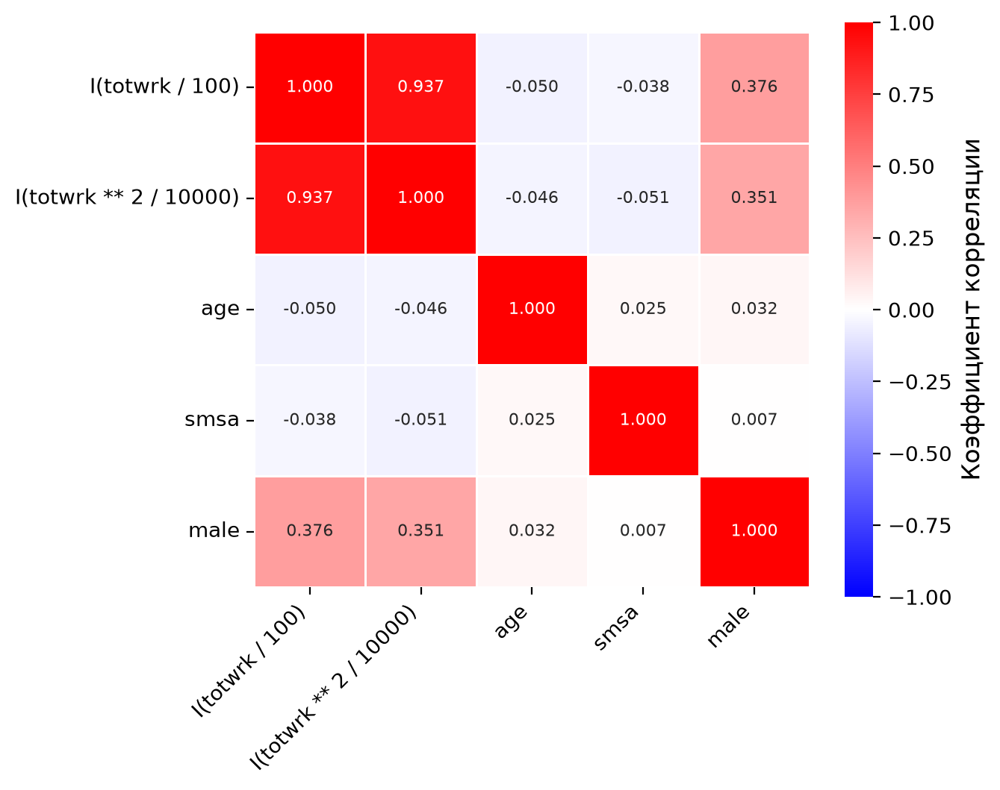
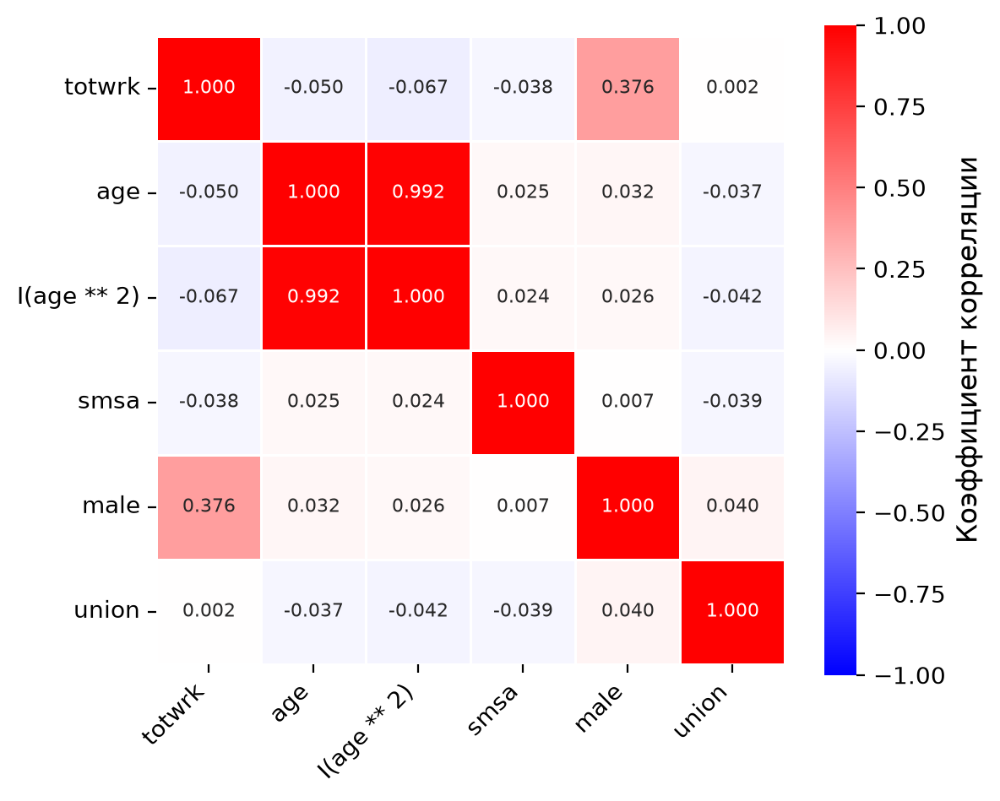
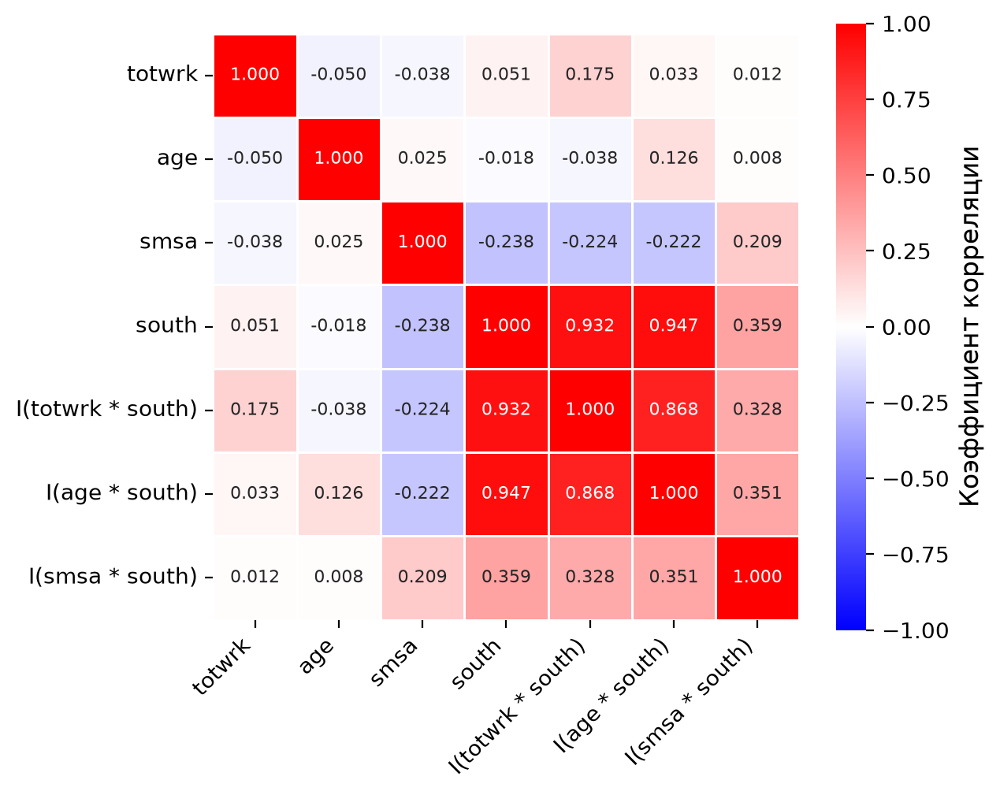
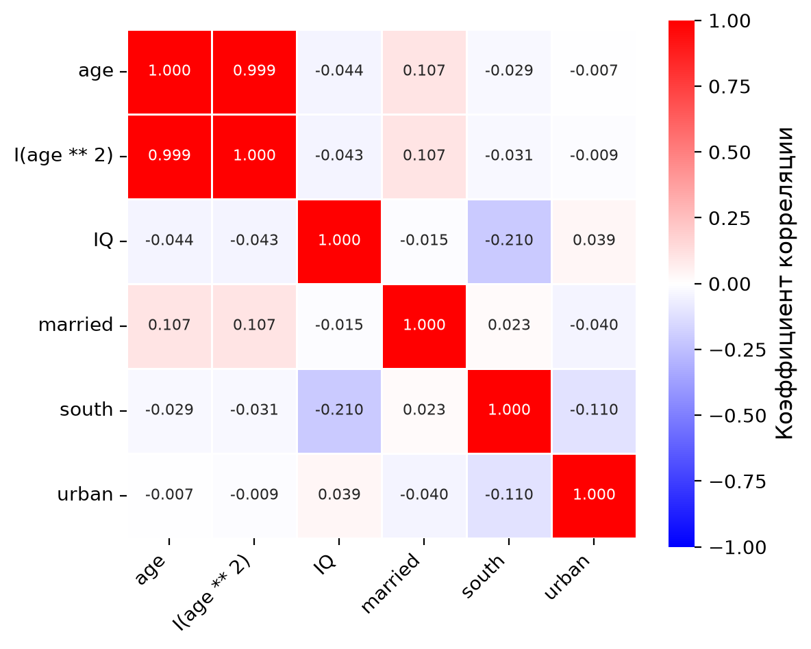
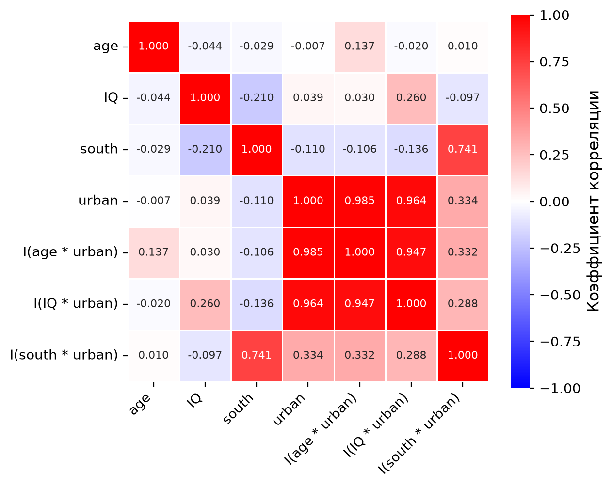

# Задачи по Эконометрике-1: Мультиколлинеарность
Н. В. Артамонов, А. Н. Лата (МГИМО МИД России)

- [Мультиколлинеарность: VIF, t-тест и
  F-тест](#мультиколлинеарность-vif-t-тест-и-f-тест)
  - [sleep equation \#1](#sleep-equation-1)
  - [sleep equation \#2](#sleep-equation-2)
  - [sleep equation \#3](#sleep-equation-3)
  - [wage equation \#1](#wage-equation-1)
  - [wage equation \#2](#wage-equation-2)

> [!IMPORTANT]
>
> ### Важно
>
> - Логарифм натуральный; константа включается в модель по умолчанию.
> - Данные — в папке `datasets/`, описание переменных — в
>   `datasets/data-description.md`.
> - VIF и критические значения округляются до 2-х десятичных знаков,
>   остальные ответы — до 3-х. Ответы считаются по неокруглённым
>   оценкам.
> - Коэффициенты подписаны как в statsmodels: `Intercept` — константа,
>   `np.log(x)` — $\log x$, `I(x ** 2)` — $x^2$, `I(x * d)` —
>   произведение $x\cdot d$.
> - Все тесты в этом листке — с **неробастными** стандартными ошибками;
>   критические значения и P-значения — по t- и F-распределениям.

# Мультиколлинеарность: VIF, t-тест и F-тест

## sleep equation \#1

Для набора данных `sleep75` рассмотрим регрессию

`sleep ~ I(totwrk/100) + I(totwrk**2/10000) + age + smsa + male`

Переменные `sleep` (сон) и `totwrk` (занятость) измерены в минутах в
неделю, `age` — в годах; `smsa`, `male`, `union`, `south` — бинарные
переменные.

Модель была подогнана по 706 наблюдениям.

Вычислите показатели VIF для регрессоров. **Ответ округлите до 2-х
десятичных знаков.**

| Переменная               |  VIF |
|:-------------------------|-----:|
| I(totwrk / 100)          | 8.37 |
| I(totwrk \*\* 2 / 10000) | 8.20 |
| age                      | 1.01 |
| smsa                     | 1.00 |
| male                     | 1.17 |

Вычислите корреляционную матрицу регрессоров. **Ответ округлите до 3-х
десятичных знаков.**

|  | I(totwrk / 100) | I(totwrk \*\* 2 / 10000) | age | smsa | male |
|:---|---:|---:|---:|---:|---:|
| I(totwrk / 100) | 1.000 | 0.937 | -0.050 | -0.038 | 0.376 |
| I(totwrk \*\* 2 / 10000) | 0.937 | 1.000 | -0.046 | -0.051 | 0.351 |
| age | -0.050 | -0.046 | 1.000 | 0.025 | 0.032 |
| smsa | -0.038 | -0.051 | 0.025 | 1.000 | 0.007 |
| male | 0.376 | 0.351 | 0.032 | 0.007 | 1.000 |

Постройте тепловую карту корреляционной матрицы
(<a href="#fig-corr-sleep1" class="quarto-xref">Рисунок 1</a>).

Рисунок 1: Корреляционная матрица регрессоров (sleep equation \#1)

> [!IMPORTANT]
>
> ### Условия теста
>
> - уровень значимости: **5%**
> - стандартные ошибки: **неробастные**
> - гипотеза 1: t-тест, значимость каждого коэффициента: $H_0:\beta_j=0$
> - гипотеза 2: F-тест, значимость влияния занятости:
>   $H_0:\beta_{totwrk/100}=\beta_{totwrk^2/10000}=0$

Какие коэффициенты значимы?

**Результаты $t$-теста для коэффициентов (неробастные стандартные
ошибки):**

|                          |    Coef. | Std.Err. | t-value | p-value | Signif. |
|:-------------------------|---------:|---------:|--------:|--------:|:--------|
| Intercept                | 3428.805 |   76.655 |  44.730 | \<0.001 |         |
| I(totwrk / 100)          |   -8.195 |    4.789 |  -1.711 |   0.088 | \*      |
| I(totwrk \*\* 2 / 10000) |   -0.214 |    0.111 |  -1.930 |   0.054 | \*      |
| age                      |    2.817 |    1.387 |   2.031 |   0.043 | \*\*    |
| smsa                     |  -78.049 |   32.072 |  -2.434 |   0.015 | \*\*    |
| male                     |   86.639 |   34.200 |   2.533 |   0.012 | \*\*    |

*Signif. codes:* `***` $p<0.01$, `**` $p<0.05$, `*` $p<0.1$

> [!NOTE]
>
> ### Коэффициенты, значимые на уровне 5% (по неробастным стандартным ошибкам)
>
> `age`, `smsa`, `male`

Проверим гипотезу о значимости влияния занятости.

**Результаты $F$-теста (неробастные стандартные ошибки):**

|      F | df1 | df2 | p-value |
|-------:|----:|----:|--------:|
| 45.619 |   2 | 700 | \<0.001 |

Вычислите критическое значение. **Ответ округлите до 2-х десятичных
знаков.**

> [!NOTE]
>
> ### Критическое значение
>
> $F_{crit} = 3.01$

Какой можно сделать вывод?

> [!TIP]
>
> ### Вывод
>
> $F = 45.619 > 3.01$, гипотеза $H_0$ отвергается.
>
> **На первый взгляд противоречие:** коэффициенты при `I(totwrk / 100)`
> и `I(totwrk ** 2 / 10000)` по отдельности незначимы (P-значения 0.088
> и 0.054), а гипотеза об их совместной незначимости отвергается. Оно
> объясняется мультиколлинеарностью: корреляция двух регрессоров равна
> 0.937, VIF — 8.37 и 8.20.

## sleep equation \#2

Для набора данных `sleep75` рассмотрим регрессию

`sleep ~ totwrk + age + I(age**2) + smsa + male + union`

Модель была подогнана по 706 наблюдениям.

Вычислите показатели VIF для регрессоров. **Ответ округлите до 2-х
десятичных знаков.**

| Переменная    |   VIF |
|:--------------|------:|
| totwrk        |  1.20 |
| age           | 65.40 |
| I(age \*\* 2) | 65.56 |
| smsa          |  1.00 |
| male          |  1.17 |
| union         |  1.01 |

Вычислите корреляционную матрицу регрессоров. **Ответ округлите до 3-х
десятичных знаков.**

|               | totwrk |    age | I(age \*\* 2) |   smsa |  male |  union |
|:--------------|-------:|-------:|--------------:|-------:|------:|-------:|
| totwrk        |  1.000 | -0.050 |        -0.067 | -0.038 | 0.376 |  0.002 |
| age           | -0.050 |  1.000 |         0.992 |  0.025 | 0.032 | -0.037 |
| I(age \*\* 2) | -0.067 |  0.992 |         1.000 |  0.024 | 0.026 | -0.042 |
| smsa          | -0.038 |  0.025 |         0.024 |  1.000 | 0.007 | -0.039 |
| male          |  0.376 |  0.032 |         0.026 |  0.007 | 1.000 |  0.040 |
| union         |  0.002 | -0.037 |        -0.042 | -0.039 | 0.040 |  1.000 |

Постройте тепловую карту корреляционной матрицы
(<a href="#fig-corr-sleep2" class="quarto-xref">Рисунок 2</a>).

Рисунок 2: Корреляционная матрица регрессоров (sleep equation \#2)

> [!IMPORTANT]
>
> ### Условия теста
>
> - уровень значимости: **5% и 10%**
> - стандартные ошибки: **неробастные**
> - гипотеза 1: t-тест, значимость каждого коэффициента: $H_0:\beta_j=0$
> - гипотеза 2: F-тест, значимость влияния возраста:
>   $H_0:\beta_{age}=\beta_{age^2}=0$

Какие коэффициенты значимы на каждом из двух уровней?

**Результаты $t$-теста для коэффициентов (неробастные стандартные
ошибки):**

|               |    Coef. | Std.Err. | t-value | p-value | Signif. |
|:--------------|---------:|---------:|--------:|--------:|:--------|
| Intercept     | 3688.551 |  218.389 |  16.890 | \<0.001 |         |
| totwrk        |   -0.165 |    0.018 |  -9.105 | \<0.001 | \*\*\*  |
| age           |   -7.734 |   11.213 |  -0.690 |   0.491 |         |
| I(age \*\* 2) |    0.127 |    0.134 |   0.948 |   0.343 |         |
| smsa          |  -74.527 |   32.156 |  -2.318 |   0.021 | \*\*    |
| male          |   86.321 |   34.329 |   2.515 |   0.012 | \*\*    |
| union         |    8.574 |   38.195 |   0.224 |   0.822 |         |

*Signif. codes:* `***` $p<0.01$, `**` $p<0.05$, `*` $p<0.1$

> [!NOTE]
>
> ### Значимые коэффициенты (по неробастным стандартным ошибкам)
>
> - на уровне 5%: `totwrk`, `smsa`, `male`
> - на уровне 10%: `totwrk`, `smsa`, `male`

Проверим гипотезу о значимости влияния возраста.

**Результаты $F$-теста (неробастные стандартные ошибки):**

|     F | df1 | df2 | p-value |
|------:|----:|----:|--------:|
| 2.497 |   2 | 699 |   0.083 |

Вычислите критические значения для двух уровней значимости. **Ответ
округлите до 2-х десятичных знаков.**

> [!NOTE]
>
> ### Критические значения
>
> - уровень значимости 5%: $F_{crit} = 3.01$
> - уровень значимости 10%: $F_{crit} = 2.31$

Какой можно сделать вывод на каждом из двух уровней?

> [!TIP]
>
> ### Вывод
>
> - На уровне 5%: $F = 2.497 < 3.01$, гипотеза $H_0$ не отвергается.
>   Противоречия нет: коэффициенты при `age` и `I(age ** 2)` незначимы
>   по отдельности (P-значения 0.491 и 0.343), и гипотеза об их
>   совместной незначимости тоже не отвергается.
> - На уровне 10%: $F = 2.497 > 2.31$, гипотеза $H_0$ отвергается, хотя
>   коэффициенты при `age` и `I(age ** 2)` по отдельности незначимы.
>   **На первый взгляд противоречие.** Оно объясняется
>   мультиколлинеарностью: корреляция `age` и `I(age ** 2)` равна 0.992,
>   VIF — 65.40 и 65.56.

## sleep equation \#3

Для набора данных `sleep75` рассмотрим регрессию

    sleep ~ totwrk + age + smsa + south +
            I(totwrk*south) + I(age*south) + I(smsa*south)

Модель была подогнана по 706 наблюдениям.

Вычислите показатели VIF для регрессоров. **Ответ округлите до 2-х
десятичных знаков.**

| Переменная         |   VIF |
|:-------------------|------:|
| totwrk             |  1.15 |
| age                |  1.25 |
| smsa               |  1.19 |
| south              | 22.00 |
| I(totwrk \* south) |  8.85 |
| I(age \* south)    | 12.28 |
| I(smsa \* south)   |  1.29 |

Вычислите корреляционную матрицу регрессоров. **Ответ округлите до 3-х
десятичных знаков.**

|  | totwrk | age | smsa | south | I(totwrk \* south) | I(age \* south) | I(smsa \* south) |
|:---|---:|---:|---:|---:|---:|---:|---:|
| totwrk | 1.000 | -0.050 | -0.038 | 0.051 | 0.175 | 0.033 | 0.012 |
| age | -0.050 | 1.000 | 0.025 | -0.018 | -0.038 | 0.126 | 0.008 |
| smsa | -0.038 | 0.025 | 1.000 | -0.238 | -0.224 | -0.222 | 0.209 |
| south | 0.051 | -0.018 | -0.238 | 1.000 | 0.932 | 0.947 | 0.359 |
| I(totwrk \* south) | 0.175 | -0.038 | -0.224 | 0.932 | 1.000 | 0.868 | 0.328 |
| I(age \* south) | 0.033 | 0.126 | -0.222 | 0.947 | 0.868 | 1.000 | 0.351 |
| I(smsa \* south) | 0.012 | 0.008 | 0.209 | 0.359 | 0.328 | 0.351 | 1.000 |

Постройте тепловую карту корреляционной матрицы
(<a href="#fig-corr-sleep3" class="quarto-xref">Рисунок 3</a>).

Рисунок 3: Корреляционная матрица регрессоров (sleep equation \#3)

> [!IMPORTANT]
>
> ### Условия теста
>
> - уровень значимости: **5%**
> - стандартные ошибки: **неробастные**
> - гипотеза 1: t-тест, значимость каждого коэффициента: $H_0:\beta_j=0$
> - гипотеза 2: F-тест, значимость региона (переменная `south`):
>   $H_0:\beta_{south}=\beta_{totwrk\cdot south}=\beta_{age\cdot south}=\beta_{smsa\cdot south}=0$

Какие коэффициенты значимы?

**Результаты $t$-теста для коэффициентов (неробастные стандартные
ошибки):**

|                    |    Coef. | Std.Err. | t-value | p-value | Signif. |
|:-------------------|---------:|---------:|--------:|--------:|:--------|
| Intercept          | 3557.513 |   75.504 |  47.117 | \<0.001 |         |
| totwrk             |   -0.161 |    0.018 |  -9.062 | \<0.001 | \*\*\*  |
| age                |    1.485 |    1.545 |   0.961 |   0.337 |         |
| smsa               |  -61.554 |   34.856 |  -1.766 |   0.078 | \*      |
| south              | -407.206 |  189.627 |  -2.147 |   0.032 | \*\*    |
| I(totwrk \* south) |    0.078 |    0.050 |   1.556 |   0.120 |         |
| I(age \* south)    |    8.267 |    3.495 |   2.365 |   0.018 | \*\*    |
| I(smsa \* south)   |   49.429 |  107.111 |   0.461 |   0.645 |         |

*Signif. codes:* `***` $p<0.01$, `**` $p<0.05$, `*` $p<0.1$

> [!NOTE]
>
> ### Коэффициенты, значимые на уровне 5% (по неробастным стандартным ошибкам)
>
> `totwrk`, `south`, `I(age * south)`

Проверим гипотезу о значимости региона.

**Результаты $F$-теста (неробастные стандартные ошибки):**

|     F | df1 | df2 | p-value |
|------:|----:|----:|--------:|
| 3.144 |   4 | 698 |   0.014 |

Вычислите критическое значение. **Ответ округлите до 2-х десятичных
знаков.**

> [!NOTE]
>
> ### Критическое значение
>
> $F_{crit} = 2.38$

Какой можно сделать вывод?

> [!TIP]
>
> ### Вывод
>
> $F = 3.144 > 2.38$, гипотеза $H_0$ отвергается.
>
> Здесь противоречия нет: коэффициенты при `south` и `I(age * south)`
> значимы и по отдельности (P-значения 0.032 и 0.018), а F-тест
> отвергает совместную незначимость всех четырёх. При этом VIF у `south`
> равен 22.00, у `I(age * south)` — 12.28: высокий VIF увеличивает
> стандартные ошибки, но сам по себе не делает коэффициент незначимым.

## wage equation \#1

Для набора данных `wage2` рассмотрим регрессию

`np.log(wage) ~ age + I(age**2) + IQ + married + south + urban`

Переменная `wage` — месячный заработок, `age` — возраст в годах, `IQ` —
результат теста IQ; `married`, `south`, `urban` — бинарные переменные.

Модель была подогнана по 935 наблюдениям.

Вычислите показатели VIF для регрессоров. **Ответ округлите до 2-х
десятичных знаков.**

| Переменная    |    VIF |
|:--------------|-------:|
| age           | 632.87 |
| I(age \*\* 2) | 632.96 |
| IQ            |   1.05 |
| married       |   1.01 |
| south         |   1.06 |
| urban         |   1.02 |

Вычислите корреляционную матрицу регрессоров. **Ответ округлите до 3-х
десятичных знаков.**

|               |    age | I(age \*\* 2) |     IQ | married |  south |  urban |
|:--------------|-------:|--------------:|-------:|--------:|-------:|-------:|
| age           |  1.000 |         0.999 | -0.044 |   0.107 | -0.029 | -0.007 |
| I(age \*\* 2) |  0.999 |         1.000 | -0.043 |   0.107 | -0.031 | -0.009 |
| IQ            | -0.044 |        -0.043 |  1.000 |  -0.015 | -0.210 |  0.039 |
| married       |  0.107 |         0.107 | -0.015 |   1.000 |  0.023 | -0.040 |
| south         | -0.029 |        -0.031 | -0.210 |   0.023 |  1.000 | -0.110 |
| urban         | -0.007 |        -0.009 |  0.039 |  -0.040 | -0.110 |  1.000 |

Постройте тепловую карту корреляционной матрицы
(<a href="#fig-corr-wage1" class="quarto-xref">Рисунок 4</a>).

Рисунок 4: Корреляционная матрица регрессоров (wage equation \#1)

> [!IMPORTANT]
>
> ### Условия теста
>
> - уровень значимости: **5%**
> - стандартные ошибки: **неробастные**
> - гипотеза 1: t-тест, значимость каждого коэффициента: $H_0:\beta_j=0$
> - гипотеза 2: F-тест, значимость влияния возраста:
>   $H_0:\beta_{age}=\beta_{age^2}=0$

Какие коэффициенты значимы?

**Результаты $t$-теста для коэффициентов (неробастные стандартные
ошибки):**

|               |  Coef. | Std.Err. | t-value | p-value | Signif. |
|:--------------|-------:|---------:|--------:|--------:|:--------|
| Intercept     |  2.938 |    1.656 |   1.774 |   0.076 |         |
| age           |  0.145 |    0.100 |   1.447 |   0.148 |         |
| I(age \*\* 2) | -0.002 |    0.002 |  -1.236 |   0.217 |         |
| IQ            |  0.008 |    0.001 |   9.770 | \<0.001 | \*\*\*  |
| married       |  0.202 |    0.040 |   5.008 | \<0.001 | \*\*\*  |
| south         | -0.100 |    0.027 |  -3.736 | \<0.001 | \*\*\*  |
| urban         |  0.173 |    0.028 |   6.260 | \<0.001 | \*\*\*  |

*Signif. codes:* `***` $p<0.01$, `**` $p<0.05$, `*` $p<0.1$

> [!NOTE]
>
> ### Коэффициенты, значимые на уровне 5% (по неробастным стандартным ошибкам)
>
> `IQ`, `married`, `south`, `urban`

Проверим гипотезу о значимости влияния возраста.

**Результаты $F$-теста (неробастные стандартные ошибки):**

|      F | df1 | df2 | p-value |
|-------:|----:|----:|--------:|
| 14.833 |   2 | 928 | \<0.001 |

Вычислите критическое значение. **Ответ округлите до 2-х десятичных
знаков.**

> [!NOTE]
>
> ### Критическое значение
>
> $F_{crit} = 3.01$

Какой можно сделать вывод?

> [!TIP]
>
> ### Вывод
>
> $F = 14.833 > 3.01$, гипотеза $H_0$ отвергается.
>
> **На первый взгляд противоречие:** коэффициенты при `age` и
> `I(age ** 2)` по отдельности незначимы (P-значения 0.148 и 0.217), а
> гипотеза об их совместной незначимости отвергается. Оно объясняется
> мультиколлинеарностью: корреляция `age` и `I(age ** 2)` равна 0.999,
> VIF — 632.87 и 632.96.

## wage equation \#2

Для набора данных `wage2` рассмотрим регрессию

    np.log(wage) ~ age + IQ + south + urban +
                   I(age*urban) + I(IQ*urban) + I(south*urban)

Модель была подогнана по 935 наблюдениям.

Вычислите показатели VIF для регрессоров. **Ответ округлите до 2-х
десятичных знаков.**

| Переменная        |    VIF |
|:------------------|-------:|
| age               |   3.39 |
| IQ                |   3.88 |
| south             |   3.83 |
| urban             | 175.88 |
| I(age \* urban)   | 114.32 |
| I(IQ \* urban)    |  53.14 |
| I(south \* urban) |   4.09 |

Вычислите корреляционную матрицу регрессоров. **Ответ округлите до 3-х
десятичных знаков.**

|  | age | IQ | south | urban | I(age \* urban) | I(IQ \* urban) | I(south \* urban) |
|:---|---:|---:|---:|---:|---:|---:|---:|
| age | 1.000 | -0.044 | -0.029 | -0.007 | 0.137 | -0.020 | 0.010 |
| IQ | -0.044 | 1.000 | -0.210 | 0.039 | 0.030 | 0.260 | -0.097 |
| south | -0.029 | -0.210 | 1.000 | -0.110 | -0.106 | -0.136 | 0.741 |
| urban | -0.007 | 0.039 | -0.110 | 1.000 | 0.985 | 0.964 | 0.334 |
| I(age \* urban) | 0.137 | 0.030 | -0.106 | 0.985 | 1.000 | 0.947 | 0.332 |
| I(IQ \* urban) | -0.020 | 0.260 | -0.136 | 0.964 | 0.947 | 1.000 | 0.288 |
| I(south \* urban) | 0.010 | -0.097 | 0.741 | 0.334 | 0.332 | 0.288 | 1.000 |

Постройте тепловую карту корреляционной матрицы
(<a href="#fig-corr-wage2" class="quarto-xref">Рисунок 5</a>).

Рисунок 5: Корреляционная матрица регрессоров (wage equation \#2)

> [!IMPORTANT]
>
> ### Условия теста
>
> - уровень значимости: **1%**
> - стандартные ошибки: **неробастные**
> - гипотеза 1: t-тест, значимость каждого коэффициента: $H_0:\beta_j=0$
> - гипотеза 2: F-тест, значимость влияния места жительства (переменная
>   `urban`):
>   $H_0:\beta_{urban}=\beta_{age\cdot urban}=\beta_{IQ\cdot urban}=\beta_{south\cdot urban}=0$

Какие коэффициенты значимы?

**Результаты $t$-теста для коэффициентов (неробастные стандартные
ошибки):**

|                   |     Coef. | Std.Err. | t-value | p-value | Signif. |
|:------------------|----------:|---------:|--------:|--------:|:--------|
| Intercept         |     4.999 |    0.312 |  16.016 | \<0.001 |         |
| age               |     0.024 |    0.007 |   3.294 |   0.001 | \*\*\*  |
| IQ                |     0.008 |    0.002 |   5.116 | \<0.001 | \*\*\*  |
| south             |    -0.014 |    0.052 |  -0.271 |   0.787 |         |
| urban             |     0.237 |    0.368 |   0.643 |   0.520 |         |
| I(age \* urban)   |    -0.001 |    0.009 |  -0.069 |   0.945 |         |
| I(IQ \* urban)    | -1.41e-05 |    0.002 |  -0.007 |   0.994 |         |
| I(south \* urban) |    -0.117 |    0.061 |  -1.924 |   0.055 | \*      |

*Signif. codes:* `***` $p<0.01$, `**` $p<0.05$, `*` $p<0.1$

> [!NOTE]
>
> ### Коэффициенты, значимые на уровне 1% (по неробастным стандартным ошибкам)
>
> `age`, `IQ`

Проверим гипотезу о значимости влияния места жительства.

**Результаты $F$-теста (неробастные стандартные ошибки):**

|      F | df1 | df2 | p-value |
|-------:|----:|----:|--------:|
| 10.250 |   4 | 927 | \<0.001 |

Вычислите критическое значение. **Ответ округлите до 2-х десятичных
знаков.**

> [!NOTE]
>
> ### Критическое значение
>
> $F_{crit} = 3.34$

Какой можно сделать вывод?

> [!TIP]
>
> ### Вывод
>
> $F = 10.250 > 3.34$, гипотеза $H_0$ отвергается.
>
> **На первый взгляд противоречие:** коэффициент при `urban` и все три
> коэффициента при взаимодействиях с `urban` по отдельности незначимы на
> уровне 1% (P-значения от 0.055 до 0.994), а гипотеза об их совместной
> незначимости отвергается. Оно объясняется мультиколлинеарностью:
> корреляции `urban` с `I(age * urban)` и `I(IQ * urban)` равны 0.985 и
> 0.964, VIF этих трёх регрессоров — 175.88, 114.32 и 53.14.
