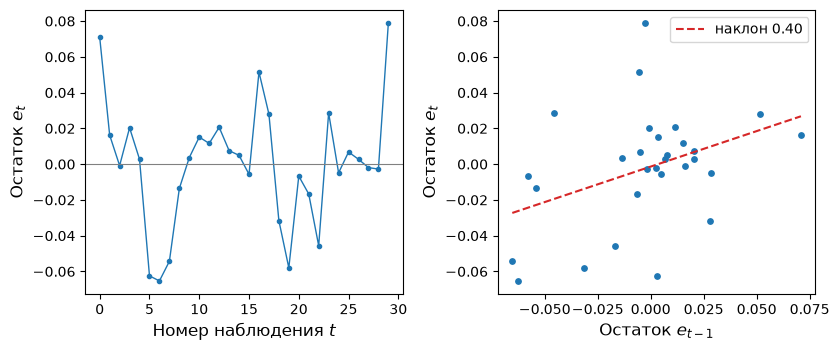
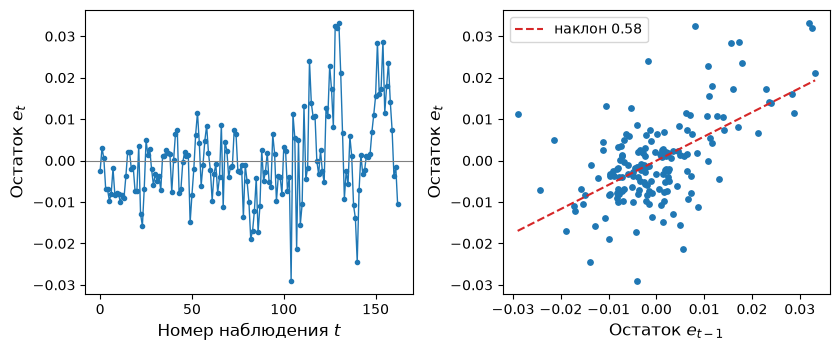

# Задачи по Эконометрике-1: Серийная корреляция
Н. В. Артамонов, А. Н. Лата (МГИМО МИД России)

- [Диагностика модели: тесты на серийную
  корреляцию](#диагностика-модели-тесты-на-серийную-корреляцию)
  - [ice cream equation](#ice-cream-equation)
  - [consumption equation](#consumption-equation)
  - [inflation equation \#1](#inflation-equation-1)
  - [inflation equation \#2](#inflation-equation-2)
  - [inflation equation \#3](#inflation-equation-3)
  - [unemployment equation](#unemployment-equation)
- [Робастный t-тест (HAC-ошибки)](#робастный-t-тест-hac-ошибки)
  - [ice cream equation](#ice-cream-equation-1)
  - [consumption equation](#consumption-equation-1)
  - [inflation equation \#1](#inflation-equation-1-1)
  - [inflation equation \#2](#inflation-equation-2-1)
  - [inflation equation \#3](#inflation-equation-3-1)
  - [unemployment equation](#unemployment-equation-1)
- [Самостоятельная задача: M2 и спреды
  ставок](#самостоятельная-задача-m2-и-спреды-ставок)

> [!IMPORTANT]
>
> ### Важно
>
> - Логарифм натуральный; константа включается в модель по умолчанию.
> - Все наборы данных — временные ряды, наблюдения упорядочены по
>   времени. Данные лежат в `datasets/`, описание переменных — в
>   `datasets/data-description.md`.
> - Запись моделей — как в формулах statsmodels, её можно скопировать в
>   `ols`: `Intercept` — константа, `np.log(x)` — $\log x$, `x.diff()` —
>   первая разность $x_t - x_{t-1}$, `np.log(x).diff()` — первая
>   разность логарифма $\log x_t - \log x_{t-1}$. У первого наблюдения
>   разности нет, поэтому при подгонке оно теряется.
> - Статистики и стандартные ошибки округляются до 3-х десятичных
>   знаков, критические значения — до 2-х. Ответы считаются по
>   неокруглённым оценкам.
> - Тест Дарбина–Уотсона: статистика — `durbin_watson(res.resid)`.
>   Границы $d_L$, $d_U$ берутся из таблицы критических значений
>   [`tables/dw-critical-values.md`](../tables/dw-critical-values.md)
>   для уровня значимости из условия, числа наблюдений $n$ и числа
>   регрессоров без константы $k$. При $DW < d_L$ гипотеза $H_0$
>   отвергается в пользу положительной автокорреляции, при
>   $DW > 4 - d_L$ — в пользу отрицательной; при $d_U < DW < 4 - d_U$
>   гипотеза не отвергается; в остальных случаях тест не даёт ответа.
> - Тест Бройша–Годфри: `acorr_breusch_godfrey(res, nlags=p)`,
>   LM-статистика; порядок `p` указан в условии.
> - Робастные стандартные ошибки — HAC (Ньюи–Уэст, ядро Бартлетта):
>   `ols(…).fit(cov_type='HAC', cov_kwds={'maxlags': L}, use_t=True)`.
>   Число лагов $L=\lfloor 4\,(n/100)^{2/9}\rfloor$, где $n$ — число
>   наблюдений в подгонке; оно указано в условии. Критические значения и
>   P-значения t-теста — по t-распределению.
> - Значимость константы не обсуждается: в списки значимых коэффициентов
>   `Intercept` не входит.

# Диагностика модели: тесты на серийную корреляцию

## ice cream equation

Для набора данных `Icecream` рассмотрим регрессию **cons на income,
price, temp**.

Переменные: `cons` — потребление мороженого на душу населения (в
пинтах), `income` — средний недельный доход семьи (в долларах США),
`price` — цена пинты мороженого, `temp` — средняя температура (в
градусах Фаренгейта). Наблюдения — четырёхнедельные, США, 1951–1953 гг.

Результаты оценивания:

| Переменная | Оценка |
|:-----------|-------:|
| Intercept  |  0.197 |
| income     |  0.003 |
| price      | -1.044 |
| temp       |  0.003 |

Модель была подогнана по 30 наблюдениям.

> [!IMPORTANT]
>
> ### Условия теста
>
> - уровень значимости: **5%**
> - тест Дарбина–Уотсона: гипотеза $H_0:\rho=0$ (автокорреляции первого
>   порядка нет); границы $d_L$, $d_U$ — для числа наблюдений $n=30$ и
>   числа регрессоров без константы $k=3$
> - тест Бройша–Годфри порядка 1, LM-статистика: гипотеза $H_0:\rho_1=0$
>   (серийной корреляции порядка 1 нет); критическое значение — по
>   распределению $\chi^2$ с числом степеней свободы 1

**DW-тест.** Вычислите тестовую статистику. Найдите критические значения
$d_L$, $d_U$. Какой можно сделать вывод? **Статистику округлите до 3-х
десятичных знаков.**

|    DW | $d_L$ | $d_U$ |
|------:|------:|------:|
| 1.021 | 1.214 | 1.650 |

> [!TIP]
>
> ### Вывод (DW-тест)
>
> $DW = 1.021 < d_L = 1.214$, гипотеза $H_0$ отвергается: положительная
> автокорреляция первого порядка.

Остатки модели показывает
<a href="#fig-icecream-resid" class="quarto-xref">Рисунок 1</a>:
соседние остатки связаны положительно.

<div id="fig-icecream-resid">



Рисунок 1: ice cream equation: остатки модели во времени и зависимость
остатка от предыдущего

</div>

**LM/BG-тест.** Проверьте модель на серийную корреляцию порядка 1.

| LM-статистика | Степени свободы | P-значение |
|--------------:|----------------:|-----------:|
|         4.237 |               1 |      0.040 |

Вычислите критическое значение. **Ответ округлите до 2-х десятичных
знаков.**

> [!NOTE]
>
> ### Критическое значение
>
> $\chi^2_{crit} = 3.84$

Какой можно сделать вывод?

> [!TIP]
>
> ### Вывод (BG-тест)
>
> $LM = 4.237 > 3.84$, гипотеза $H_0$ отвергается: серийная корреляция
> порядка 1 есть.

## consumption equation

Для набора данных `Consumption` рассмотрим регрессию **np.log(yd).diff()
на np.log(ce).diff()**.

Переменные: `yd` — располагаемый личный доход, `ce` — личные
потребительские расходы (оба ряда — в долларах 1986 г.). Наблюдения —
квартальные, Канада, 1947–1996 гг.

Результаты оценивания:

| Переменная        | Оценка |
|:------------------|-------:|
| Intercept         |  0.006 |
| np.log(ce).diff() |  0.371 |

Модель была подогнана по 199 наблюдениям.

> [!IMPORTANT]
>
> ### Условия теста
>
> - уровень значимости: **1%**
> - тест Дарбина–Уотсона: гипотеза $H_0:\rho=0$ (автокорреляции первого
>   порядка нет); границы $d_L$, $d_U$ — для числа наблюдений $n=199$ и
>   числа регрессоров без константы $k=1$
> - тест Бройша–Годфри порядка 2, LM-статистика: гипотеза
>   $H_0:\rho_1=\rho_2=0$ (серийной корреляции порядка 2 нет);
>   критическое значение — по распределению $\chi^2$ с числом степеней
>   свободы 2

**DW-тест.** Вычислите тестовую статистику. Найдите критические значения
$d_L$, $d_U$. Какой можно сделать вывод? **Статистику округлите до 3-х
десятичных знаков.**

|    DW | $d_L$ | $d_U$ |
|------:|------:|------:|
| 2.382 | 1.663 | 1.683 |

> [!TIP]
>
> ### Вывод (DW-тест)
>
> $DW = 2.382 > 4 - d_L = 2.337$, гипотеза $H_0$ отвергается:
> отрицательная автокорреляция первого порядка.

**LM/BG-тест.** Проверьте модель на серийную корреляцию порядка 2.

| LM-статистика | Степени свободы | P-значение |
|--------------:|----------------:|-----------:|
|         8.913 |               2 |      0.012 |

Вычислите критическое значение. **Ответ округлите до 2-х десятичных
знаков.**

> [!NOTE]
>
> ### Критическое значение
>
> $\chi^2_{crit} = 9.21$

Какой можно сделать вывод?

> [!TIP]
>
> ### Вывод (BG-тест)
>
> $LM = 8.913 < 9.21$, гипотеза $H_0$ не отвергается: серийная
> корреляция порядка 2 не выявлена. Выводы двух тестов расходятся:
> DW-тест гипотезу об отсутствии автокорреляции отвергает, а BG-тест
> порядка 2 на уровне 1% не отвергает.

## inflation equation \#1

Для набора данных `Mishkin` рассмотрим регрессию **pai3.diff() на
tb3.diff(), np.log(cpi).diff()**.

Переменные: `pai3` — трёхмесячный темп инфляции (в процентах годовых),
`tb3` — ставка по трёхмесячным казначейским векселям (в процентах
годовых), `cpi` — индекс потребительских цен (среднее за 1982–1984 гг.
равно 100). Наблюдения — месячные, США, 1950–1990 гг.

Результаты оценивания:

| Переменная         |  Оценка |
|:-------------------|--------:|
| Intercept          |   0.162 |
| tb3.diff()         |   0.081 |
| np.log(cpi).diff() | -44.823 |

Модель была подогнана по 490 наблюдениям.

> [!IMPORTANT]
>
> ### Условия теста
>
> - уровень значимости: **1%**
> - тест Дарбина–Уотсона: гипотеза $H_0:\rho=0$ (автокорреляции первого
>   порядка нет); границы $d_L$, $d_U$ — для числа наблюдений $n=490$ и
>   числа регрессоров без константы $k=2$
> - тест Бройша–Годфри порядка 2, LM-статистика: гипотеза
>   $H_0:\rho_1=\rho_2=0$ (серийной корреляции порядка 2 нет);
>   критическое значение — по распределению $\chi^2$ с числом степеней
>   свободы 2

**DW-тест.** Вычислите тестовую статистику. Найдите критические значения
$d_L$, $d_U$. Какой можно сделать вывод? **Статистику округлите до 3-х
десятичных знаков.**

|    DW | $d_L$ | $d_U$ |
|------:|------:|------:|
| 1.621 | 1.782 | 1.799 |

> [!TIP]
>
> ### Вывод (DW-тест)
>
> $DW = 1.621 < d_L = 1.782$, гипотеза $H_0$ отвергается: положительная
> автокорреляция первого порядка.

**LM/BG-тест.** Проверьте модель на серийную корреляцию порядка 2.

| LM-статистика | Степени свободы | P-значение |
|--------------:|----------------:|-----------:|
|        17.200 |               2 |    \<0.001 |

Вычислите критическое значение. **Ответ округлите до 2-х десятичных
знаков.**

> [!NOTE]
>
> ### Критическое значение
>
> $\chi^2_{crit} = 9.21$

Какой можно сделать вывод?

> [!TIP]
>
> ### Вывод (BG-тест)
>
> $LM = 17.200 > 9.21$, гипотеза $H_0$ отвергается: серийная корреляция
> порядка 2 есть.

## inflation equation \#2

Для набора данных `Tbrate` рассмотрим регрессию **pi.diff() на y.diff(),
r.diff()**.

Переменные: `pi` — темп инфляции, `y` — логарифм реального ВВП, `r` —
ставка по 91-дневным казначейским векселям. Наблюдения — квартальные,
Канада, 1950–1996 гг.

Результаты оценивания:

| Переменная | Оценка |
|:-----------|-------:|
| Intercept  |  0.091 |
| y.diff()   | -9.130 |
| r.diff()   |  0.311 |

Модель была подогнана по 187 наблюдениям.

> [!IMPORTANT]
>
> ### Условия теста
>
> - уровень значимости: **5%**
> - тест Дарбина–Уотсона: гипотеза $H_0:\rho=0$ (автокорреляции первого
>   порядка нет); границы $d_L$, $d_U$ — для числа наблюдений $n=187$ и
>   числа регрессоров без константы $k=2$
> - тест Бройша–Годфри порядка 1, LM-статистика: гипотеза $H_0:\rho_1=0$
>   (серийной корреляции порядка 1 нет); критическое значение — по
>   распределению $\chi^2$ с числом степеней свободы 1

**DW-тест.** Вычислите тестовую статистику. Найдите критические значения
$d_L$, $d_U$. Какой можно сделать вывод? **Статистику округлите до 3-х
десятичных знаков.**

|    DW | $d_L$ | $d_U$ |
|------:|------:|------:|
| 2.459 | 1.739 | 1.782 |

> [!TIP]
>
> ### Вывод (DW-тест)
>
> $DW = 2.459 > 4 - d_L = 2.261$, гипотеза $H_0$ отвергается:
> отрицательная автокорреляция первого порядка.

**LM/BG-тест.** Проверьте модель на серийную корреляцию порядка 1.

| LM-статистика | Степени свободы | P-значение |
|--------------:|----------------:|-----------:|
|        10.683 |               1 |      0.001 |

Вычислите критическое значение. **Ответ округлите до 2-х десятичных
знаков.**

> [!NOTE]
>
> ### Критическое значение
>
> $\chi^2_{crit} = 3.84$

Какой можно сделать вывод?

> [!TIP]
>
> ### Вывод (BG-тест)
>
> $LM = 10.683 > 3.84$, гипотеза $H_0$ отвергается: серийная корреляция
> порядка 1 есть.

## inflation equation \#3

Для набора данных `MoneyUS` рассмотрим регрессию

`infl.diff() ~ y.diff() + tbr.diff() + cpr.diff() + m.diff()`

Переменные: `infl` — квартальный темп инфляции (в процентах годовых),
`y` — логарифм реального ВВП, `tbr` — ставка по казначейским векселям,
`cpr` — ставка по коммерческим бумагам (в процентах годовых), `m` —
логарифм реальной денежной массы M1. Наблюдения — квартальные, США,
1954–1994 гг.

Результаты оценивания (оценки в этой задаче малы по величине, поэтому
приведены с 5 десятичными знаками):

| Переменная |   Оценка |
|:-----------|---------:|
| Intercept  | -0.00013 |
| y.diff()   | -0.00241 |
| tbr.diff() |  0.00017 |
| cpr.diff() |  0.40710 |
| m.diff()   | -0.00124 |

Модель была подогнана по 163 наблюдениям.

> [!IMPORTANT]
>
> ### Условия теста
>
> - уровень значимости: **1%**
> - тест Дарбина–Уотсона: гипотеза $H_0:\rho=0$ (автокорреляции первого
>   порядка нет); границы $d_L$, $d_U$ — для числа наблюдений $n=163$ и
>   числа регрессоров без константы $k=4$
> - тест Бройша–Годфри порядка 2, LM-статистика: гипотеза
>   $H_0:\rho_1=\rho_2=0$ (серийной корреляции порядка 2 нет);
>   критическое значение — по распределению $\chi^2$ с числом степеней
>   свободы 2

**DW-тест.** Вычислите тестовую статистику. Найдите критические значения
$d_L$, $d_U$. Какой можно сделать вывод? **Статистику округлите до 3-х
десятичных знаков.**

|    DW | $d_L$ | $d_U$ |
|------:|------:|------:|
| 0.834 | 1.590 | 1.689 |

> [!TIP]
>
> ### Вывод (DW-тест)
>
> $DW = 0.834 < d_L = 1.590$, гипотеза $H_0$ отвергается: положительная
> автокорреляция первого порядка.

Остатки модели показывает
<a href="#fig-moneyus-resid" class="quarto-xref">Рисунок 2</a>: соседние
остатки связаны положительно.

<div id="fig-moneyus-resid">



Рисунок 2: inflation equation \#3: остатки модели во времени и
зависимость остатка от предыдущего

</div>

**LM/BG-тест.** Проверьте модель на серийную корреляцию порядка 2.

| LM-статистика | Степени свободы | P-значение |
|--------------:|----------------:|-----------:|
|        61.893 |               2 |    \<0.001 |

Вычислите критическое значение. **Ответ округлите до 2-х десятичных
знаков.**

> [!NOTE]
>
> ### Критическое значение
>
> $\chi^2_{crit} = 9.21$

Какой можно сделать вывод?

> [!TIP]
>
> ### Вывод (BG-тест)
>
> $LM = 61.893 > 9.21$, гипотеза $H_0$ отвергается: серийная корреляция
> порядка 2 есть.

## unemployment equation

Для набора данных `Macrodat` рассмотрим регрессию

``` python
lhur.diff() ~ np.log(punew).diff() + fyff.diff() + fygm3.diff() +
              fygt1.diff() + np.log(gdpjp).diff()
```

Переменные: `lhur` — уровень безработицы (в процентах), `punew` — индекс
потребительских цен, `fyff` — ставка по федеральным фондам, `fygm3` и
`fygt1` — ставки по трёхмесячным и годовым казначейским бумагам, `gdpjp`
— реальный ВВП Японии. Наблюдения — квартальные, США, 1959–2000 гг.

Результаты оценивания:

| Переменная           | Оценка |
|:---------------------|-------:|
| Intercept            | -0.141 |
| np.log(punew).diff() | 12.720 |
| fyff.diff()          | -0.115 |
| fygm3.diff()         |  0.168 |
| fygt1.diff()         | -0.166 |
| np.log(gdpjp).diff() | -0.399 |

Модель была подогнана по 161 наблюдению.

В наборе 168 кварталов; последние 6 значений `gdpjp` пропущены, ещё одно
наблюдение теряется при взятии разности.

> [!IMPORTANT]
>
> ### Условия теста
>
> - уровень значимости: **1%**
> - тест Дарбина–Уотсона: гипотеза $H_0:\rho=0$ (автокорреляции первого
>   порядка нет); границы $d_L$, $d_U$ — для числа наблюдений $n=161$ и
>   числа регрессоров без константы $k=5$
> - тест Бройша–Годфри порядка 2, LM-статистика: гипотеза
>   $H_0:\rho_1=\rho_2=0$ (серийной корреляции порядка 2 нет);
>   критическое значение — по распределению $\chi^2$ с числом степеней
>   свободы 2

**DW-тест.** Вычислите тестовую статистику. Найдите критические значения
$d_L$, $d_U$. Какой можно сделать вывод? **Статистику округлите до 3-х
десятичных знаков.**

|    DW | $d_L$ | $d_U$ |
|------:|------:|------:|
| 1.063 | 1.574 | 1.701 |

> [!TIP]
>
> ### Вывод (DW-тест)
>
> $DW = 1.063 < d_L = 1.574$, гипотеза $H_0$ отвергается: положительная
> автокорреляция первого порядка.

**LM/BG-тест.** Проверьте модель на серийную корреляцию порядка 2.

| LM-статистика | Степени свободы | P-значение |
|--------------:|----------------:|-----------:|
|        35.658 |               2 |    \<0.001 |

Вычислите критическое значение. **Ответ округлите до 2-х десятичных
знаков.**

> [!NOTE]
>
> ### Критическое значение
>
> $\chi^2_{crit} = 9.21$

Какой можно сделать вывод?

> [!TIP]
>
> ### Вывод (BG-тест)
>
> $LM = 35.658 > 9.21$, гипотеза $H_0$ отвергается: серийная корреляция
> порядка 2 есть.

# Робастный t-тест (HAC-ошибки)

## ice cream equation

Для набора данных `Icecream` рассмотрим регрессию **cons на income,
price, temp**.

> [!IMPORTANT]
>
> ### Условия теста
>
> - уровень значимости: **1%**
> - стандартные ошибки: **неробастные и робастные HAC (Ньюи–Уэст, ядро
>   Бартлетта), `maxlags = 3`**
> - гипотеза: $H_0:\beta_j=0$ для каждого коэффициента, альтернатива
>   двусторонняя
> - число лагов: $L=\lfloor 4\,(n/100)^{2/9}\rfloor = 3$ при $n=30$

**Результаты $t$-теста для коэффициентов (неробастные стандартные
ошибки):**

|           |  Coef. | Std.Err. | t-value | p-value | Signif. |
|:----------|-------:|---------:|--------:|--------:|:--------|
| Intercept |  0.197 |    0.270 |   0.730 |   0.472 |         |
| income    |  0.003 |    0.001 |   2.824 |   0.009 | \*\*\*  |
| price     | -1.044 |    0.834 |  -1.252 |   0.222 |         |
| temp      |  0.003 | 0.000446 |   7.762 | \<0.001 | \*\*\*  |

*Signif. codes:* `***` $p<0.01$, `**` $p<0.05$, `*` $p<0.1$

Какие коэффициенты значимы?

> [!NOTE]
>
> ### Коэффициенты, значимые на уровне 1% (по неробастным стандартным ошибкам)
>
> `income`, `temp`

**Результаты $t$-теста для коэффициентов (робастные стандартные ошибки,
HAC):**

|           |  Coef. | Std.Err. | t-value | p-value | Signif. |
|:----------|-------:|---------:|--------:|--------:|:--------|
| Intercept |  0.197 |    0.314 |   0.627 |   0.536 |         |
| income    |  0.003 |    0.001 |   2.676 |   0.013 | \*\*    |
| price     | -1.044 |    0.910 |  -1.148 |   0.261 |         |
| temp      |  0.003 | 0.000373 |   9.282 | \<0.001 | \*\*\*  |

*Signif. codes:* `***` $p<0.01$, `**` $p<0.05$, `*` $p<0.1$

Какие коэффициенты значимы?

> [!NOTE]
>
> ### Коэффициенты, значимые на уровне 1% (по робастным стандартным ошибкам HAC)
>
> `temp`

## consumption equation

Для набора данных `Consumption` рассмотрим регрессию **np.log(yd).diff()
на np.log(ce).diff()**.

> [!IMPORTANT]
>
> ### Условия теста
>
> - уровень значимости: **1%**
> - стандартные ошибки: **неробастные и робастные HAC (Ньюи–Уэст, ядро
>   Бартлетта), `maxlags = 4`**
> - гипотеза: $H_0:\beta_j=0$ для каждого коэффициента, альтернатива
>   двусторонняя
> - число лагов: $L=\lfloor 4\,(n/100)^{2/9}\rfloor = 4$ при $n=199$

**Результаты $t$-теста для коэффициентов (неробастные стандартные
ошибки):**

|                   | Coef. | Std.Err. | t-value | p-value | Signif. |
|:------------------|------:|---------:|--------:|--------:|:--------|
| Intercept         | 0.006 |    0.001 |   5.252 | \<0.001 |         |
| np.log(ce).diff() | 0.371 |    0.068 |   5.483 | \<0.001 | \*\*\*  |

*Signif. codes:* `***` $p<0.01$, `**` $p<0.05$, `*` $p<0.1$

Какие коэффициенты значимы?

> [!NOTE]
>
> ### Коэффициенты, значимые на уровне 1% (по неробастным стандартным ошибкам)
>
> `np.log(ce).diff()`

**Результаты $t$-теста для коэффициентов (робастные стандартные ошибки,
HAC):**

|                   | Coef. | Std.Err. | t-value | p-value | Signif. |
|:------------------|------:|---------:|--------:|--------:|:--------|
| Intercept         | 0.006 |    0.001 |   4.943 | \<0.001 |         |
| np.log(ce).diff() | 0.371 |    0.079 |   4.668 | \<0.001 | \*\*\*  |

*Signif. codes:* `***` $p<0.01$, `**` $p<0.05$, `*` $p<0.1$

Какие коэффициенты значимы?

> [!NOTE]
>
> ### Коэффициенты, значимые на уровне 1% (по робастным стандартным ошибкам HAC)
>
> `np.log(ce).diff()`

## inflation equation \#1

Для набора данных `Mishkin` рассмотрим регрессию **pai3.diff() на
tb3.diff(), np.log(cpi).diff()**.

> [!IMPORTANT]
>
> ### Условия теста
>
> - уровень значимости: **1%**
> - стандартные ошибки: **неробастные и робастные HAC (Ньюи–Уэст, ядро
>   Бартлетта), `maxlags = 5`**
> - гипотеза: $H_0:\beta_j=0$ для каждого коэффициента, альтернатива
>   двусторонняя
> - число лагов: $L=\lfloor 4\,(n/100)^{2/9}\rfloor = 5$ при $n=490$

**Результаты $t$-теста для коэффициентов (неробастные стандартные
ошибки):**

|                    |   Coef. | Std.Err. | t-value | p-value | Signif. |
|:-------------------|--------:|---------:|--------:|--------:|:--------|
| Intercept          |   0.162 |    0.087 |   1.860 |   0.063 |         |
| tb3.diff()         |   0.081 |    0.112 |   0.726 |   0.468 |         |
| np.log(cpi).diff() | -44.823 |   17.130 |  -2.617 |   0.009 | \*\*\*  |

*Signif. codes:* `***` $p<0.01$, `**` $p<0.05$, `*` $p<0.1$

Какие коэффициенты значимы?

> [!NOTE]
>
> ### Коэффициенты, значимые на уровне 1% (по неробастным стандартным ошибкам)
>
> `np.log(cpi).diff()`

**Результаты $t$-теста для коэффициентов (робастные стандартные ошибки,
HAC):**

|                    |   Coef. | Std.Err. | t-value | p-value | Signif. |
|:-------------------|--------:|---------:|--------:|--------:|:--------|
| Intercept          |   0.162 |    0.075 |   2.156 |   0.032 |         |
| tb3.diff()         |   0.081 |    0.082 |   0.986 |   0.325 |         |
| np.log(cpi).diff() | -44.823 |   19.480 |  -2.301 |   0.022 | \*\*    |

*Signif. codes:* `***` $p<0.01$, `**` $p<0.05$, `*` $p<0.1$

Какие коэффициенты значимы?

> [!NOTE]
>
> ### Коэффициенты, значимые на уровне 1% (по робастным стандартным ошибкам HAC)
>
> Значимых коэффициентов не выявлено.

## inflation equation \#2

Для набора данных `Tbrate` рассмотрим регрессию **pi.diff() на y.diff(),
r.diff()**.

> [!IMPORTANT]
>
> ### Условия теста
>
> - уровень значимости: **5%**
> - стандартные ошибки: **неробастные и робастные HAC (Ньюи–Уэст, ядро
>   Бартлетта), `maxlags = 4`**
> - гипотеза: $H_0:\beta_j=0$ для каждого коэффициента, альтернатива
>   двусторонняя
> - число лагов: $L=\lfloor 4\,(n/100)^{2/9}\rfloor = 4$ при $n=187$

**Результаты $t$-теста для коэффициентов (неробастные стандартные
ошибки):**

|           |  Coef. | Std.Err. | t-value | p-value | Signif. |
|:----------|-------:|---------:|--------:|--------:|:--------|
| Intercept |  0.091 |    0.187 |   0.488 |   0.626 |         |
| y.diff()  | -9.130 |   12.400 |  -0.736 |   0.462 |         |
| r.diff()  |  0.311 |    0.156 |   1.990 |   0.048 | \*\*    |

*Signif. codes:* `***` $p<0.01$, `**` $p<0.05$, `*` $p<0.1$

Какие коэффициенты значимы?

> [!NOTE]
>
> ### Коэффициенты, значимые на уровне 5% (по неробастным стандартным ошибкам)
>
> `r.diff()`

**Результаты $t$-теста для коэффициентов (робастные стандартные ошибки,
HAC):**

|           |  Coef. | Std.Err. | t-value | p-value | Signif. |
|:----------|-------:|---------:|--------:|--------:|:--------|
| Intercept |  0.091 |    0.161 |   0.563 |   0.574 |         |
| y.diff()  | -9.130 |   13.899 |  -0.657 |   0.512 |         |
| r.diff()  |  0.311 |    0.116 |   2.687 |   0.008 | \*\*\*  |

*Signif. codes:* `***` $p<0.01$, `**` $p<0.05$, `*` $p<0.1$

Какие коэффициенты значимы?

> [!NOTE]
>
> ### Коэффициенты, значимые на уровне 5% (по робастным стандартным ошибкам HAC)
>
> `r.diff()`

## inflation equation \#3

Для набора данных `MoneyUS` рассмотрим регрессию

`infl.diff() ~ y.diff() + tbr.diff() + cpr.diff() + m.diff()`

> [!IMPORTANT]
>
> ### Условия теста
>
> - уровень значимости: **1%**
> - стандартные ошибки: **неробастные и робастные HAC (Ньюи–Уэст, ядро
>   Бартлетта), `maxlags = 4`**
> - гипотеза: $H_0:\beta_j=0$ для каждого коэффициента, альтернатива
>   двусторонняя
> - число лагов: $L=\lfloor 4\,(n/100)^{2/9}\rfloor = 4$ при $n=163$

Оценки в этой задаче малы по величине, поэтому таблицы приведены с 5
десятичными знаками.

**Результаты $t$-теста для коэффициентов (неробастные стандартные
ошибки):**

|            |    Coef. | Std.Err. |  t-value | p-value | Signif. |
|:-----------|---------:|---------:|---------:|--------:|:--------|
| Intercept  | -0.00013 |  0.00110 | -0.12168 | 0.90331 |         |
| y.diff()   | -0.00241 |  0.00260 | -0.92798 | 0.35483 |         |
| tbr.diff() |  0.00017 |  0.00302 |  0.05510 | 0.95612 |         |
| cpr.diff() |  0.40710 |  0.09904 |  4.11063 | \<0.001 | \*\*\*  |
| m.diff()   | -0.00124 |  0.00049 | -2.52660 | 0.01250 | \*\*    |

*Signif. codes:* `***` $p<0.01$, `**` $p<0.05$, `*` $p<0.1$

Какие коэффициенты значимы?

> [!NOTE]
>
> ### Коэффициенты, значимые на уровне 1% (по неробастным стандартным ошибкам)
>
> `cpr.diff()`

**Результаты $t$-теста для коэффициентов (робастные стандартные ошибки,
HAC):**

|            |    Coef. | Std.Err. |  t-value | p-value | Signif. |
|:-----------|---------:|---------:|---------:|--------:|:--------|
| Intercept  | -0.00013 |  0.00159 | -0.08400 | 0.93317 |         |
| y.diff()   | -0.00241 |  0.00292 | -0.82599 | 0.41005 |         |
| tbr.diff() |  0.00017 |  0.00325 |  0.05116 | 0.95926 |         |
| cpr.diff() |  0.40710 |  0.09853 |  4.13172 | \<0.001 | \*\*\*  |
| m.diff()   | -0.00124 |  0.00035 | -3.58564 | \<0.001 | \*\*\*  |

*Signif. codes:* `***` $p<0.01$, `**` $p<0.05$, `*` $p<0.1$

Какие коэффициенты значимы?

> [!NOTE]
>
> ### Коэффициенты, значимые на уровне 1% (по робастным стандартным ошибкам HAC)
>
> `cpr.diff()`, `m.diff()`

## unemployment equation

Для набора данных `Macrodat` рассмотрим регрессию

``` python
lhur.diff() ~ np.log(punew).diff() + fyff.diff() + fygm3.diff() +
              fygt1.diff() + np.log(gdpjp).diff()
```

> [!IMPORTANT]
>
> ### Условия теста
>
> - уровень значимости: **1%**
> - стандартные ошибки: **неробастные и робастные HAC (Ньюи–Уэст, ядро
>   Бартлетта), `maxlags = 4`**
> - гипотеза: $H_0:\beta_j=0$ для каждого коэффициента, альтернатива
>   двусторонняя
> - число лагов: $L=\lfloor 4\,(n/100)^{2/9}\rfloor = 4$ при $n=161$

**Результаты $t$-теста для коэффициентов (неробастные стандартные
ошибки):**

|                      |  Coef. | Std.Err. | t-value | p-value | Signif. |
|:---------------------|-------:|---------:|--------:|--------:|:--------|
| Intercept            | -0.141 |    0.049 |  -2.895 |   0.004 |         |
| np.log(punew).diff() | 12.720 |    3.022 |   4.209 | \<0.001 | \*\*\*  |
| fyff.diff()          | -0.115 |    0.034 |  -3.375 | \<0.001 | \*\*\*  |
| fygm3.diff()         |  0.168 |    0.069 |   2.415 |   0.017 | \*\*    |
| fygt1.diff()         | -0.166 |    0.058 |  -2.872 |   0.005 | \*\*\*  |
| np.log(gdpjp).diff() | -0.399 |    1.736 |  -0.230 |   0.818 |         |

*Signif. codes:* `***` $p<0.01$, `**` $p<0.05$, `*` $p<0.1$

Какие коэффициенты значимы?

> [!NOTE]
>
> ### Коэффициенты, значимые на уровне 1% (по неробастным стандартным ошибкам)
>
> `np.log(punew).diff()`, `fyff.diff()`, `fygt1.diff()`

**Результаты $t$-теста для коэффициентов (робастные стандартные ошибки,
HAC):**

|                      |  Coef. | Std.Err. | t-value | p-value | Signif. |
|:---------------------|-------:|---------:|--------:|--------:|:--------|
| Intercept            | -0.141 |    0.043 |  -3.247 |   0.001 |         |
| np.log(punew).diff() | 12.720 |    3.384 |   3.759 | \<0.001 | \*\*\*  |
| fyff.diff()          | -0.115 |    0.046 |  -2.516 |   0.013 | \*\*    |
| fygm3.diff()         |  0.168 |    0.052 |   3.210 |   0.002 | \*\*\*  |
| fygt1.diff()         | -0.166 |    0.058 |  -2.853 |   0.005 | \*\*\*  |
| np.log(gdpjp).diff() | -0.399 |    1.465 |  -0.272 |   0.786 |         |

*Signif. codes:* `***` $p<0.01$, `**` $p<0.05$, `*` $p<0.1$

Какие коэффициенты значимы?

> [!NOTE]
>
> ### Коэффициенты, значимые на уровне 1% (по робастным стандартным ошибкам HAC)
>
> `np.log(punew).diff()`, `fygm3.diff()`, `fygt1.diff()`

# Самостоятельная задача: M2 и спреды ставок

Из базы данных [FRED](https://fred.stlouisfed.org/) загрузите месячные
данные с 2000-01 по 2023-12:

- M2 (`M2SL`);
- доходность 3-месячных казначейских векселей (`TB3MS`);
- доходность 10-летних казначейских облигаций (`GS10`);
- доходность корпоративных облигаций рейтинга Aaa (`AAA`) и Baa (`BAA`).

Ряд можно загрузить прямо в pandas:

``` python
url = 'https://fred.stlouisfed.org/graph/fredgraph.csv?id=M2SL'
m2 = pd.read_csv(url, index_col=0, parse_dates=True)
```

Рассмотрим регрессию первой разности спреда `BAA - AAA` на первую
разность спреда `GS10 - TB3MS` и первую разность `np.log(M2SL)`.

1.  Сформируйте набор данных.
2.  Подгоните модель и проверьте её на серийную корреляцию порядка 1 и
    порядка 2.
3.  Проведите неробастный и робастный (HAC, `maxlags = 5`) t-тест и
    сравните результаты.
4.  Проведите неробастный и робастный F-тест на значимость регрессии и
    сравните результаты.

Ответ к задаче не приводится: данные FRED пересматриваются, и числа со
временем меняются.
